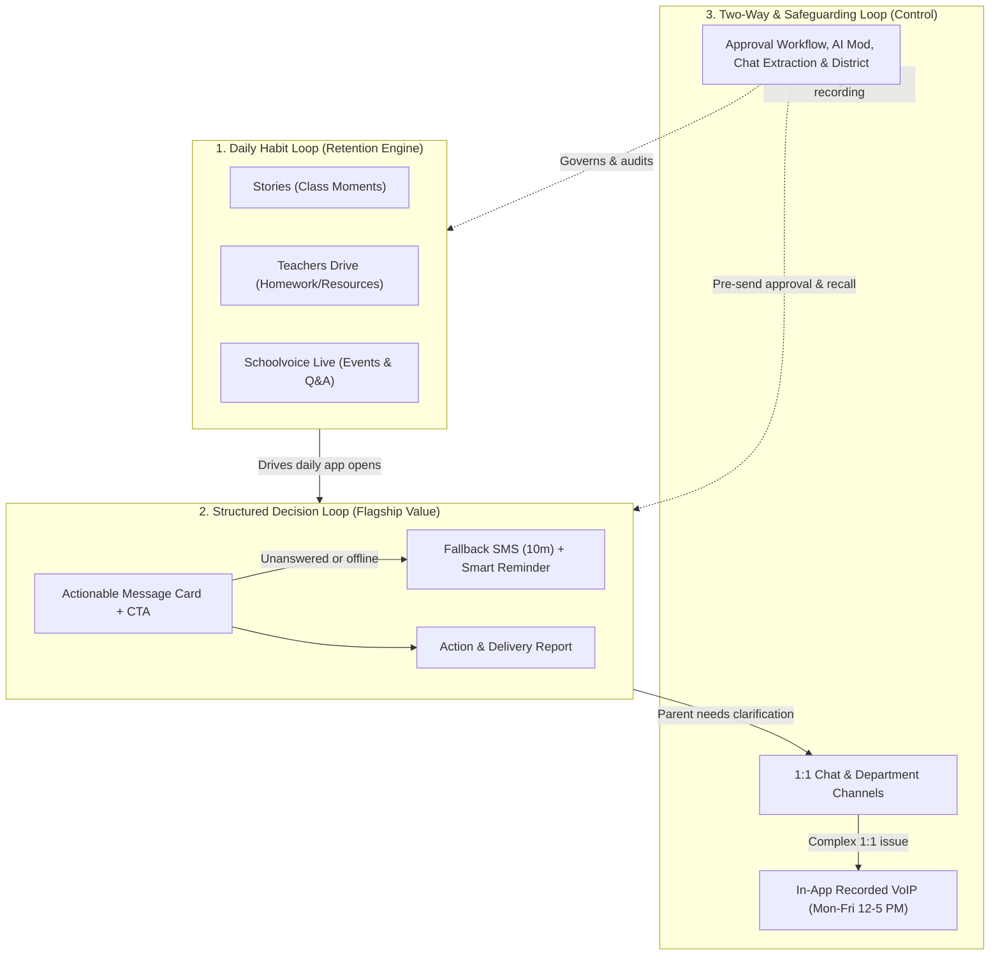
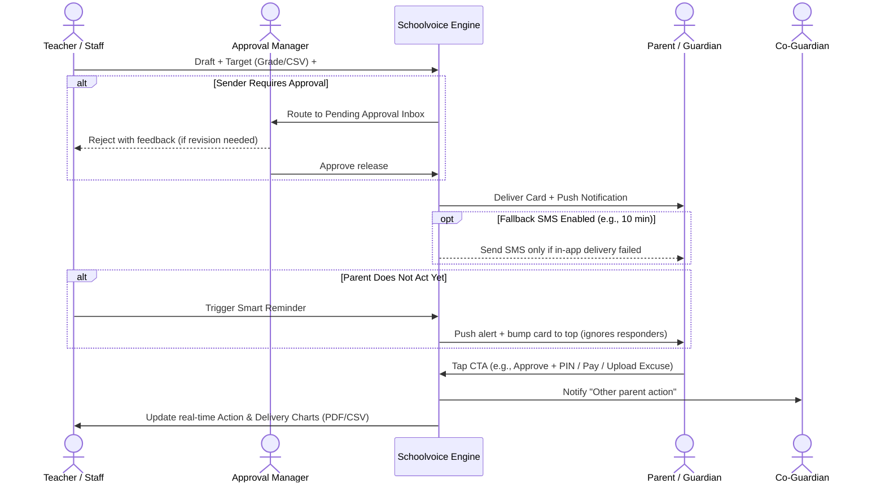

# 00 — How Schoolvoice Works (Product Mental Model)

> [!abstract] Navigation
> **Hub**: [[_Master Document Hub]] | **Visual Flow**: [[Master Document - Visual Map.canvas]] | **Next**: [[01 - Overview & Value Proposition]]

---

## Why Schoolvoice Exists (The Two Problems It Solves)

Most schools oscillate between two broken extremes:
1. **Consumer Chat Apps (e.g., WhatsApp)**: High engagement, but chaotic—teachers leak personal phone numbers, management has zero oversight or audit trail, sensitive files get lost in chat scrollback, and critical approvals get buried in group chatter.
2. **Legacy School Portals**: Controlled, but low engagement—parents only open them once a month for report cards, so urgent trip forms, fee requests, and emergency alerts go unnoticed.

**Schoolvoice's Core Thesis**: Combine **daily emotional/academic value** (so parents open the app every day) with **structured one-tap actions and governed communication** (so every critical school request gets answered quickly, privately, and auditably).

---

## The 3 Connected Product Loops

1. **Daily Habit Loop (Pull)**: [[04 - Stories, Teachers Drive & Live Broadcasting|Stories, Teachers Drive & Live]] give parents classroom photos, study files, and live Q&As—building a daily open habit without nagging.
2. **Structured Decision Loop (Act)**: [[02 - Actionable Messages|Actionable Messages]] leverage that daily attention so broadcasts aren't passive text—they present **1-tap CTA cards** (`Approve` + PIN, `Pay`, `Submit Absence/Tardiness`, `Reply`), backed by automated **10-minute Fallback SMS** and non-responder **Smart Reminders**.
3. **Two-Way & Safeguarding Loop (Talk & Govern)**: [[03 - Chat & Voice Calls|Chat, Channels & Voice Calls]] handle inbound questions without personal mobile numbers, while [[05 - Reports, District Management & Admin TBAs|Reports & District Management]] verify real adoption (`Reach >= 1 active guardian`) and scale oversight across ministries/school groups.

---

## Who Uses What: Persona & Journey Matrix

Grounded in [[Most-important|Stakeholder Priority]] (**School Admins & Parents = #1**, followed by **Teachers &  Students**):

| Persona                                                               | Primary Goal ("Job to Be Done")                                                                            | Key Touchpoints in Schoolvoice                                                                                                                  | Non-Negotiable Constraints / Rules                                                                                                                                                                            |
| :-------------------------------------------------------------------- | :--------------------------------------------------------------------------------------------------------- | :---------------------------------------------------------------------------------------------------------------------------------------------- | :------------------------------------------------------------------------------------------------------------------------------------------------------------------------------------------------------------ |
| **Parents / Guardians** *(Priority #1)*                               | Stay informed on child's school life and act on requests in seconds—even with low tech literacy.           | Message Feed (CTA cards), PIN Approvals, Excuse Uploads, Stories, Drive, Live, 1:1 Chat, Dept Channels, VoIP Calls                              | Never sees teacher personal numbers; sees only own private channel threads; call hours shown in parent's **local timezone**; synced with second guardian via `Other parent action` alerts.                    |
| **School Admin / Management** *(Priority #1)*                         | Guarantee high parent reachability, protect school tone/safeguarding, and prove compliance.                | Approval Inbox, View Other Sent Messages, Message Recall, Chat Extraction, VoIP Recordings & Quotas, Install & Reach Reports                    | Pre-send gates for `Senders Requiring Approval`; regular chats private by default (extraction leaves an **audit trail**); **9 Admin settings modules still `TBA`**.                                           |
| **Teachers & Homeroom Staff** *(Priority #2)*                         | Communicate clearly with parents and share class updates/files **without sharing personal phone numbers**. | Targeting (Grade/Section/CSV), `#variables`, `Message Merge`, Drafts, Chat Availability toggle, VoIP (Mon–Fri 12–5 PM), Stories, Teachers Drive | Can post Stories **only** for their own students' parents; outside VoIP hours, parents see schedule + `Message Teacher` while staff can still initiate outgoing calls; leaving staff lose access immediately. |
| **Department Staff** *(Tuition, SEN, Bus, Admissions, Wellbeing, IT)* | Resolve operational parent inquiries as a coordinated team without leaking sensitive cases.                | Shared **Chat Channels** (RBAC-controlled)                                                                                                      | Assigned staff see unified internal/external thread per parent; sensitive channels (`Special Needs`, `Wellbeing`) restricted to authorized roles only.                                                        |
| **District / Ministry / School Group**                                | Standardize messaging quality and benchmark reach across multiple branches and schools.                    | `District → Branches → Schools → Grades`, Cross-school Messaging, Cross-school Recall/Delete, Filtered Reports                                  | Can recall/delete messages across subsidiary schools and roll up Installation/Reach analytics by district, branch, or school.                                                                                 |

---

## End-to-End Lifecycle: One Actionable Request

---

## Core Concept Disambiguation ("Don't Confuse These!")

| Concept A                     | Concept B                                         | The Critical Difference                                                                                                                                                                                                                                           |
| :---------------------------- | :------------------------------------------------ | :---------------------------------------------------------------------------------------------------------------------------------------------------------------------------------------------------------------------------------------------------------------- |
| **Smart Reminder**            | **Fallback SMS**                                  | **Smart Reminder** nudges parents who **received** the app message but haven't **acted** (bumps card to top, skips responders). **Fallback SMS** catches parents who **haven't received** it in-app (offline / no app) after an interval (e.g., 10 min).          |
| **Personalization Variables** | **Message Merge**                                 | **Variables** (`#parent_name`, `#student_grade`) inject text tokens dynamically. **Message Merge** links those variables to an external folder (e.g., Google Drive) to **auto-attach per-student files** like report cards.                                       |
| **Message Recall**            | **Message Delete**                                | **Message Recall** disables an already-sent card on parent devices, stamps it `"Recalled Message"`, and **keeps the audit record**. **Message Delete** is heading #16 with **no spec yet** (active PO TO-DO: [[After On-Boarding To-Do]]).                        |
| **Installation Report**       | **Reach Report**                                  | **Installation** counts device installs (`%` installed + Android/iOS split across guardians, staff, students). **Reach** checks whether a **student** has at least **1 active connected guardian** able to receive messages.                                      |
| **1:1 Chat / Channel**        | **Reply Request (`1-to-many` vs `many-to-many`)** | **Chat** is conversational messaging (private 1:1 or private parent thread inside a multi-staff Department Channel). **Reply Request** is an Actionable Message card where `1-to-many` collects private parent replies and `many-to-many` opens group discussion. |
| **Approval Workflow**         | **Authorized Chat Extraction**                    | **Approval Workflow** is **preventative** (blocks message before it reaches parents). **Chat Extraction** is **investigative** (exports normally-private 1:1 chats post-hoc with a logged audit trail).                                                           |
