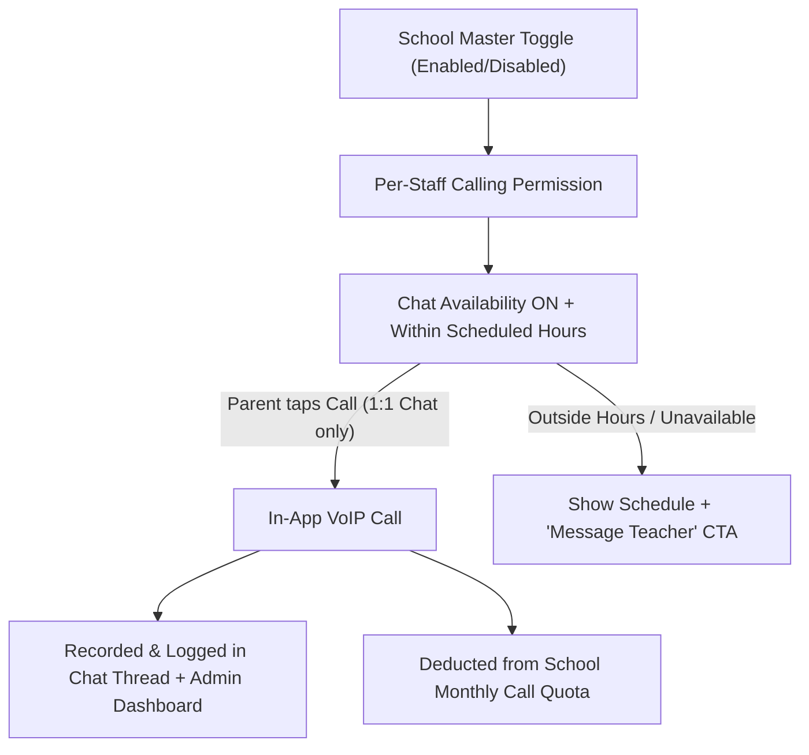

# 03 — Instant Messaging (Chat) & Voice Calls

> [!abstract] Navigation
> **Hub**: [[_Master Document Hub]] | **Mental Model**: [[00 - How Schoolvoice Works (Product Mental Model)]] | **Prev**: [[02 - Actionable Messages]] | **Next**: [[04 - Stories, Teachers Drive & Live Broadcasting]]

> [!tip] Product Lens — Why Governed Chat & VoIP Matter
> Schools ban WhatsApp because personal phone numbers leak, chats go unmoderated, and departing teachers take parent contacts with them. Schoolvoice replaces off-channel talk with **number-private chat**, **RBAC department queues**, **on-demand audit extraction**, and **100% recorded 1:1 VoIP** gated by availability hours and monthly minute quotas.

Schoolvoice combines structured 1:1 messaging, topic-based department channels, privacy-by-default governance, and in-app VoIP calling so all real-time parent–staff interactions stay inside one official, auditable channel.

---

## Instant Messaging (Chat)

### Core Capabilities
- **Number Privacy**: Parents and teachers chat without ever exposing personal mobile numbers.
- **Cross-Platform Access**: Available on both **mobile apps** and **web dashboard**.
- **Built-in Translation**: Reduces language barriers between diverse families and school staff.
- **Rich Media & Voice Notes**: Exchange images, videos, documents, and quick voice note messages to prevent text misunderstandings.
- **Contextual Profiles**: View contact profile & student relationship context directly inside the chat.
- **Teacher Availability Status**: Teachers toggle availability on/off to manage parent response expectations.
- **Real-Time AI Moderation**: Automatically filters inappropriate or unacceptable content in real time.
- **Management Oversight**: School administrators maintain visibility and governance controls over communication standards.

### Chat Channels (Department & Topic Queues)
Enables schools to organize inbound parent inquiries into **unlimited dedicated channels** staffed by multiple team members.

- **Collaborative Staff Replies**: Assigned staff members view the parent thread and each other's replies to deliver unified responses.
- **Parent-to-Parent Privacy**: ==Each parent only sees their own private thread== with the channel's staff—never other parents' messages.
- **Role-Based Access Control (RBAC)**: Restrict sensitive channels exclusively to authorized staff.
- **Simple Admin UI & Real-Time Alerts**: Create/edit/delete channels, manage members anytime, and receive instant notifications.

> [!example]- Channel Examples from Source Document
> - **School Tuition**: Payment deadlines, fee structures, scholarships
> - **Academic Advising**: Progress discussions, curriculum queries
> - **Bus Transportation**: Route updates, delays, lost-and-found
> - **Admissions / Events & Activities**: Enrollment questions, volunteering, events
> - **Special Needs Support**: Personalized SEN assistance *(restricted access)*
> - **Wellbeing & Counselling**: Confidential counsellor conversations *(restricted access)*
> - **IT Support**: Troubleshooting school digital platforms

### Chat Extraction (Governance & Safeguarding)
- **Privacy by Default**: Regular chats remain private from management unless an extraction is explicitly triggered.
- **On-Demand Authorized Extraction**: Only specially authorized admins can extract a specific parent–teacher chat history.
- **Audit Trail**: Every extraction logs an audit trail for transparency and accountability.
- **Use Cases**: Dispute resolution, investigating complaints/incidents, teacher coaching, and communication QA.

---

## Voice Calls (In-App VoIP)

> [!info] Note on Doc Structure
> Voice Calls has a full specification in the doc body, though it was omitted from the 6-module list at the top of the document.

### Problems Voice Calls Solves
| Legacy Pain Point | How In-App Voice Calls Solves It |
| --- | --- |
| **Personal Number Leaks** | Calls run over internet (VoIP) inside the app—==zero phone numbers exchanged==. |
| **Unlogged External Calls** | Every call is recorded, timestamped, and logged in the thread and admin dashboard. |
| **Company Phones & SIM Costs** | Eliminates buying hardware/SIMs while enforcing call permissions, hours, and monthly minute quotas. |
| **Teacher Offboarding Risk** | Revoking a departing teacher's Schoolvoice account ==immediately revokes parent access==—no saved numbers walk out the door. |
| **Off-Channel Communication** | Keeps sensitive or emotional 2-minute calls inside one official, school-owned channel. |

### Architecture & Key Rules

- **1-to-1 Only**: Placed directly from an existing 1:1 chat thread (==not available in group/broadcast channels==).
- **Two-Tier Enablement**: School-level master switch + per-staff admin permission.
- **Staff Availability Windows**:
  - Configurable per day (start/end times); defaults to **Monday–Friday, 12:00 PM – 5:00 PM**.
  - **Timezone Aware**: Shown to parents in their own local timezone (helpful for traveling parents).
  - **Asymmetric Rule**: Outside available hours, parents cannot call (they see the schedule + a `"Message Teacher"` option), while ==staff can still place outgoing calls==.
  - **Tied to Chat Status**: Turning off chat availability automatically disables incoming calls.
- **Caller Identification & In-Call UI**:
  - Relationship-aware caller ID: e.g., `"Ahmed – Teacher of Omar"` or `"Ali – Father of Mohamed"`.
  - Clean call screen: name, photo, live timer, mute, speaker, end call.
- **Safeguarding, Logging & Notifications**:
  - **100% Call Recording**: Stored and reviewable in an admin dashboard filtered by staff member, duration, and timestamp.
  - **Unified Call History**: `Completed`, `Missed`, `Declined`, `Busy`, and `Failed` calls all log inline in the chat thread (mobile & web).
  - **Missed-Call Push Alerts**: Triggered whether the app is open, backgrounded, or closed.
- **Monthly Call Quota**: School-wide configurable minute quota tracked and enforced automatically with clear in-app exhaustion notices.
