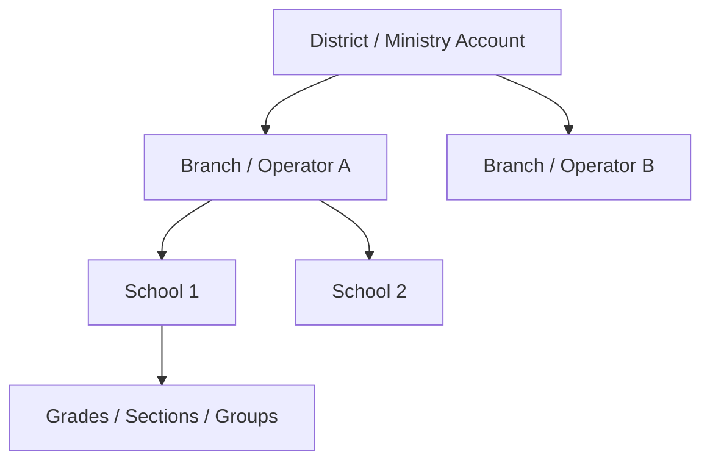

# 05 — Reports, District Management & Admin TBAs

> [!abstract] Navigation
> **Hub**: [[_Master Document Hub]] | **Mental Model**: [[00 - How Schoolvoice Works (Product Mental Model)]] | **Prev**: [[04 - Stories, Teachers Drive & Live Broadcasting]]

> [!tip] Product Lens — Measuring Reach & Discovering What's Missing
> **Reach Report** defines true operational readiness (`>= 1 active guardian` connected per student). **District Management** scales oversight across ministries/school groups. For a new PO, the **PO Gap & TBA Tracker** below is the highest-leverage list for stakeholder discovery—especially `Message delete` (linked to [[After On-Boarding To-Do]]) and the `9 Admin TBAs`.

This section covers platform-level adoption analytics, multi-school/ministry governance, and the **9 Admin Modules** currently marked `TBA` in the Master Document.

---

## Schoolvoice Reports (Adoption & Reach)

Both platform reports support **PDF** and **CSV** exports:

| Report | Goal | Visual Chart | Table Columns |
| --- | --- | --- | --- |
| **Installation Report** | Track app install adoption across **guardians, staff, and students** | % Installed vs. Not Installed, split by **Android vs. iOS** | `User Name`, `Device Type`, `OS Version`, `App Version`, `App Build Version`, `Mobile` |
| **Reach Report** | Measure student reachability (==student counts as reached if **at least 1 guardian** is installed & connected==) | Reached Students vs. Unreached Students | `Student Name`, `Total Guardians`, `Active Guardians` (connected & receiving messages) |

---

## District Management (Ministries & Multi-School Groups)

Built for **ministries of education** and **school groups** managing multiple schools or diverse curricula under one institutional umbrella.

- **Flexible Hierarchy**: `District → Branches / Operators → Schools → Grades / Sections / Groups`.
- **Enhanced Communication Control**: Monitor communications across schools with authority to **delete or recall** messages to enforce institutional standards.
- **Unified Multi-Level Targeting**: Send messages to parents of an individual school or the entire district from a single account.
- **Cross-Entity Analytics**: Filter reach %, installation rate, sent message volume, and active users at the **district**, **branch**, or **individual school** level.

---

## PO Gap & TBA Tracker

> [!warning] Incomplete Specifications Requiring PO Discovery
> The following items are either completely stubbed (`TBA`) or missing body text in the source Master Document.

### Admin Modules (All 9 Currently `TBA`)
- [ ] **Contact management** (`TBA`)
- [ ] **Permission management** (`TBA`)
- [ ] **Challenges management** (`TBA` — likely connects to missing *Rewards & Challenges* module #4)
- [ ] **Absence management** (`TBA` — clarify overlap/sync with *Absence & Tardiness* actionable message)
- [ ] **School structure management** (`TBA`)
- [ ] **School profile management** (`TBA`)
- [ ] **Modules management** (`TBA`)
- [ ] **SMS settings** (`TBA` — clarify link to *Fallback SMS* feature)
- [ ] **Admin logs** (`TBA`)

### Other Source Document Gaps
- [ ] **Rewards and Challenges** — Listed as #4 in `Schoolvoice Modules` overview, no body section exists.
- [ ] **Voice Calls** — Full body section exists, missing from `Schoolvoice Modules` top list.
- [ ] **Message Delete** — Heading #16 under Cross Actionable Message Features is empty (`TO-DO` note in vault mentions user stories for delete messages!).
- [ ] **Parent feedback attachment** — Empty bullet under Actionable Messages Reports per-student breakdown.
- [ ] **Stories Views** — Empty bullet under Stories interactive features.
