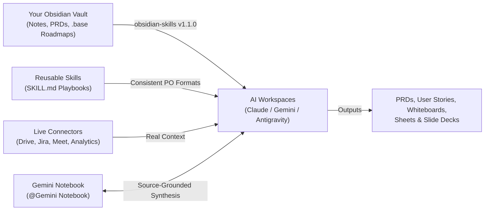

# PO 30-Day AI Catchup (2026-10-17 to 2026-11-16)

> [!abstract] Executive TL;DR — What Changed for Non-Technical Product Owners
> Between **October 17 and November 16, 2026**, AI tools shifted decisively away from "one prompt in a single chat box" toward **no-code collaborative workspaces, portable playbooks (`Skills`), and non-coder agent interfaces**:
> 1. **Visual & Data Collaboration Inside Chat:** Claude launched **Whiteboards**, **Sheets**, **Data**, side-by-side **Interactive Connectors**, and **Meetings** (Nov 10), while Google Sheets added standalone **Canvas / Mini-App** links (Nov 2026).
> 2. **"Skills" Went Mainstream & Cross-Platform:** Anthropic donated the `SKILL.md` **Agent Skills** format to the Linux Foundation (Oct 22), Google began rolling out stackable **Skills** across Google Workspace (Nov 9), and Obsidian shipped **`obsidianmd/obsidian-skills` v1.1.0** (Nov 11).
> 3. **AI Agents Added Non-Coder Interfaces:** Google Antigravity launched its dedicated **Knowledge Work** layout (Nov 9) and **Voice Mode** (Nov 6), letting POs run research, PRD drafting, and vault workflows without seeing Git branches or code diffs.

> [!info] Plain-English Guide: What are "AI Skills" & Connectors?
> Think of your daily PO workflow like running a kitchen:
> - **Prompts** are one-off instructions you type from scratch every time (*"Turn these 5 interview notes into user stories"*).
> - **Reusable Skills (`SKILL.md`)** are saved **playbooks or SOPs** stored as a simple Markdown file or workspace preset (e.g., `/schoolvoice-prd-template` or `obsidian-markdown`). Instead of pasting a 40-line prompt every morning, you type `/` or `@`—or let the AI auto-detect it—so the assistant always follows your exact structure, tone, and acceptance-criteria format. Because Anthropic donated `SKILL.md` to an open foundation on Oct 22, one playbook is increasingly portable across Claude, Gemini, Antigravity, and Obsidian.
> - **Connectors (Interactive Apps & MCP)** are **secure bridges** to tools you already use (Google Drive, Gmail, Atlassian/Jira, Salesforce, Amplitude, or your local Obsidian vault). Instead of downloading CSVs or copy-pasting tickets, the AI reads live context or opens the partner tool right beside your conversation.
> - **Tasks / Proactive Agents** are **background helpers** (like Claude Duet or Antigravity Knowledge Work) that gather updates, run multi-step research, or prep morning briefings—and pause to ask your approval before sending messages or changing records.

---

## Snapshot: Highest-Impact Releases for POs

| Date | Platform | Release / Feature | Primary PO Value |
| :--- | :--- | :--- | :--- |
| **Nov 13, 2026** | Google Antigravity | App `v2.32.0` Dynamic Workflows & Browser Guardrails | Multi-step research fan-outs with safer web browsing |
| **Nov 12, 2026** | Google Antigravity | **Gemini 4 Hydrogen** (`xhigh`) & **Orchestrator** | Fast daily execution + automatic deep-planning routing |
| **Nov 12, 2026** | Obsidian | **Obsidian `v1.15.1`** (Relevance Sort, Multi-Lang Search, Mobile Web Viewer) | Faster search across bilingual/large PO vaults |
| **Nov 11, 2026** | Obsidian | **`obsidianmd/obsidian-skills` `v1.1.0`** | AI safely edits Markdown, `.base` trackers, & `.canvas` boards |
| **Nov 10, 2026** | Claude | **Whiteboards (Beta), Sheets (Beta), Data (GA), Interactive Connectors & Meetings (Beta)** | End-to-end discovery, prioritization, analytics, & Google Meet capture |
| **Nov 10, 2026** | Google Antigravity | **Gemini 4 Carbon** & `/swarm` Preview (`v2.31.0`) | Parallel specialist agents (e.g., Researcher + PRD Writer + Reviewer) |
| **Nov 9, 2026** | Google Antigravity | **Knowledge Work Interface Layout** (`v2.30.0+`) | Strips out Git/code diffs; clean workspace for non-coders |
| **Nov 9, 2026** | Google Gemini | **Skills Rollout in Google Workspace** (Docs, Slides, Drive, Gmail, Chat) | Stackable `/` skills & collaborative Skill drafting in Google Docs |
| **Nov 6, 2026** | Google Antigravity | **Voice Mode** (`v2.29`, Gemini Live) | Hands-free brainstorming, dictation, & verbal task approvals |
| **Nov 2, 2026** | Obsidian | **Obsidian `v1.15.0`** (*Pele* Mermaid, Bases Filter Reordering, iOS Voice Capture) | Clean PRD diagrams, backlog triage, & voice-to-note capture |
| **Oct 23, 2026** | Gemini / Notebook | **`@Gemini Notebook` Connected App** | Query, create, & populate notebooks straight from Gemini chat |
| **Oct 22, 2026** | Anthropic / AAIF | **Agent Skills Open Standard Donation** (`agentskills.io`) | Portable `SKILL.md` playbooks across major AI tools |
| **Oct 21, 2026** | Claude | **Claude Duet** (Research Preview) | Proactive morning briefs & background cloud assistant with approval cards |
| **Oct 19, 2026** | Gemini Notebook | **Steerable Slide Decks & Video Overviews** | Edit outlines/producer notes *before* generating stakeholder decks |

---

## 1. Claude (Anthropic)

### Claude Whiteboards, Claude Sheets, Claude Data & Interactive Connectors
- **Release Date:** **November 10, 2026** (Whiteboards & Sheets in Beta for paid plans; Claude Data GA; Interactive Connectors rollout) — [Claude Resources](https://claude.com/resources/articles/more-ways-to-work-with-claude-sheets-whiteboards-and-interactive-connectors), [Interactive Connectors](https://claude.com/resources/articles/interactive-connectors-full-tool)
- **What Changed:**
  - **Claude Whiteboards (Beta):** A real-time visual canvas on Web, Desktop, and Mobile where you turn rough text prompts or verbal brain dumps into grouped themes, user flows, and owner/date timelines—and convert finished boards into docs or slides.
  - **Claude Sheets (Beta):** Multi-tab spreadsheets co-built with Claude inside the workspace, complete with formulas, conditional formatting, and dropdown menus.
  - **Claude Data (GA):** Formerly *Claude Dashboards*, connects to analytics and warehouse tools (such as **Amplitude, Mixpanel, PostHog, Sigma, ThoughtSpot, Omni, Salesforce, Snowflake, BigQuery, Redshift, ClickHouse**) to build cached, version-tracked data stories and certified metric queries.
  - **Interactive Connectors:** Opens partner tools—including **Atlassian (Jira/Confluence), Adobe, Box, HubSpot, Salesforce, Workday, and NetSuite**—as live interactive app panels right beside your Claude conversation so you can click and edit without tab-hopping.
- **PO Use Cases:**
  - *Discovery & Stakeholder Synthesis:* Paste raw school-admin or parent interviews, cluster pain points on a **Whiteboard**, and convert the board directly into an executive alignment doc.
  - *Backlog Prioritization:* Build a RICE/WSJF scoring matrix in **Claude Sheets** with dropdowns for priority tiers, then review live Jira issues in an **Interactive Connector** side panel.
  - *Product Analytics:* Ask **Claude Data** to compare onboarding drop-offs in Amplitude/Mixpanel before scoping a sprint fix.

### Claude Meetings (Beta)
- **Release Date:** Announced **November 10, 2026**; rolling out in **November 2026** (Beta for Team & Enterprise on Web & Claude Desktop) — [Claude Meetings](https://claude.com/resources/articles/claude-meetings), [Claude Release Notes](https://support.claude.com/en/articles/12138966-release-notes)
- **What Changed:** Claude can join **Google Meet** calls as a visible participant to transcribe discussions, take structured notes, answer factual questions mid-call, and generate live artifacts (docs, whiteboards, or slide decks) while stakeholders talk.
- **PO Use Cases:**
  - *Sprint Reviews & Discovery Calls:* Capture live stakeholder decisions, open questions, and scope changes directly into a draft PRD or Whiteboard during the call instead of spending an hour cleaning up transcripts afterward.

### Claude Duet (Research Preview)
- **Release Date:** **October 21, 2026** (Waitlist Research Preview for US Pro, Max, and Ultra plans; Team/Enterprise excluded in initial wave) — [Claude Duet](https://claude.com/resources/articles/claude-duet)
- **What Changed:** A standalone proactive agent app (iOS, Android, and `claude.ai`) running in its own cloud VM. Instead of waiting for your prompt, Duet sends a **morning brief** summarizing connected email, calendar, Slack, and project tools, works on multi-step prep in the background, and enforces **human-in-the-loop Approval Cards** before any high-stakes action (sending messages, signing docs, deleting files). It inherits your Claude memory and custom **Skills**.
- **PO Use Cases:**
  - *Daily Triage & Follow-ups:* Surface unanswered stakeholder threads, overnight support escalations, and prep briefs for upcoming school demos before your morning standup.

### Agent Skills Open Standard & Ecosystem Updates
- **Release Dates:** **October 22, 2026** (AAIF donation), **November 9, 2026** (Claude Fable 5.2), **November 12, 2026** (Claude for Manufacturing blueprint) — [Anthropic News](https://www.anthropic.com/news/donating-agent-skills-to-the-agentic-ai-foundation), [Claude Fable 5.2](https://www.anthropic.com/claude-fable-and-mythos-5-2), [Claude for Manufacturing](https://claude.com/solutions/manufacturing)
- **What Changed:**
  - **Open Standard (`agentskills.io`):** Anthropic donated the **Agent Skills** (`SKILL.md`) format and repo to the Linux Foundation's **Agentic AI Foundation (AAIF)**, cementing vendor-neutral portability across 70+ platforms.
  - **Unified Customize Menu & Skill Sync (Fall 2026):** Claude's **Customize** panel centralizes skills, plugins, and connectors, syncing web skills across desktop workflows. *(Note: Cowork's "Record a Skill" screen/voice capture launched earlier on July 21, 2026, and remained a flagship no-code way to record workflows into Skills this fall.)*
  - **Role-Based Plugin Packs (`Nov 12`):** *Claude for Manufacturing* demonstrated Anthropic's new vertical packaging pattern—bundling **17 workflow skills + 4 connectors** into one toggleable plugin.
  - **Claude Fable 5.2 (`Nov 9`):** 30% faster token generation (plus optional 2.5× fast mode) with stronger multi-step reasoning for dense documents and planning.
- **PO Use Cases:**
  - *Knowledge Management & Standards:* Write one reusable `SKILL.md` for your team's PRD rubric or Gherkin acceptance criteria and reuse it across tools without vendor lock-in.

---

## 2. Google Gemini & Google Workspace

### Gemini Skills Replacing Gems & Google Workspace Rollout
- **Release Dates:** **November 9, 2026** (Google Workspace rollout began after October reliability/safety tuning); **October 13 – mid-November 2026** (Gemini App gradual rollout); originally announced **September 30, 2026** — [Workspace Skills Launch (Nov 2026)](https://workspaceupdates.googleblog.com/2026/11/skills-in-workspace.html), [Oct 2026 Update](https://workspaceupdates.googleblog.com/2026/10/an-update-on-launch-of-skills-in-gemini-app-and-workspace.html), [Google Blog](https://blog.google/products-and-platforms/products/gemini/automate-tasks-with-skills/)
- **What Changed:**
  - **Inline & Stackable:** Unlike older Gems (which trapped you in separate single-purpose mini-chats), **Skills** run inline inside any normal Gemini or Workspace chat using `/` or `@` shortcuts—or trigger automatically when relevant. You can **stack multiple skills** in one prompt (e.g., `/discovery-synthesis` + `/executive-tone`).
  - **Centralized Customize Hub:** The Gemini side menu's **Customize** hub brings Skills and Connected Apps together in one place.
  - **Workspace Co-Authoring (Nov 9):** Workspace users can draft, test, and collaborate on Skills directly inside **Google Docs**, and use Skills across **Gmail, Docs, Slides, Drive, and Chat**. *(Important caveats verified in Google docs: Skills are not yet supported inside Google Sheets or Google Meet, and Skills do not yet auto-sync between the personal Gemini app and Workspace accounts; personal Gems begin migrating in Nov 2026.)*
- **PO Use Cases:**
  - *User Stories & PRDs:* Co-author a shared "User Story & Acceptance Criteria Skill" in Google Docs with your BA/PM peers so anyone drafting specs in Docs gets consistent outputs.
  - *Stakeholder Comms:* Stack a `/release-notes-format` skill with a `/school-principal-tone` skill directly in Gmail or Docs.

### `@Gemini Notebook` Connected App in Gemini Chat
- **Release Date:** **October 23, 2026** (enabled by default globally; opt-out in EEA) — [Workspace Updates](https://workspaceupdates.googleblog.com/2026/10/take-actions-on-your-notebooks-from-Gemini-Notebook-directly-in-the-Gemini-app.html)
- **What Changed:** You can now type `@Gemini Notebook` inside a regular Gemini conversation to create new notebooks, send your current Gemini chat transcript or sources into a notebook, retrieve grounded answers from existing notebooks, or list/clean up notes via plain language.
- **PO Use Cases:**
  - *Discovery-to-PRD Bridge:* Brainstorm product hypotheses in Gemini Chat, then type `@Gemini Notebook` to push those notes into your "Parent Engagement Discovery" notebook and pull cited customer quotes back into your draft.

### Google Sheets Canvas Standalone Links & Google Chat Productivity
- **Release Date:** **November 2026** — [Google Workspace Updates](https://workspaceupdates.googleblog.com/2026/)
- **What Changed:**
  - **Sheets Canvas / Mini-Apps:** Gemini-generated mini-apps inside Sheets (kanban boards, trackers, calendars, dashboards) can now be published as **standalone read-only links** for stakeholders.
  - **Google Chat:** Added **1-click meeting scheduling** via Gemini when scheduling intent is detected (groups up to 5), plus **numbered and nested lists** for cleaner project updates.
- **PO Use Cases:**
  - *Stakeholder Visibility:* Share a live interactive roadmap or sprint-health mini-app from Google Sheets via a standalone link without exposing underlying raw spreadsheet formulas.

### Gemini Tasks (formerly Spark) & Gemini macOS App Context
- **Observed Timeline:** Ongoing Fall / Oct–Nov 2026 rollout alongside Gemini macOS integration *(note: Gemini Spark's initial macOS/Connected Apps announcement dates back to [June 2026](https://blog.google/innovation-and-ai/products/gemini-app/gemini-spark-updates-june-2026/), while the Oct–Nov 2026 cycle consolidated background delegation as **Tasks** and integrated Antigravity into the macOS Gemini app per [Gemini Release Notes](https://gemini.google/release-notes/))*
- **PO Use Cases:**
  - *Routine Admin:* Offload recurring weekly summaries or folder/invoice cleanup on desktop without manual scripting.

---

## 3. Google Antigravity (Non-Coding & Knowledge Work)

Google Antigravity made a major push in early-to-mid November 2026 specifically for non-engineering roles (product, ops, research, finance, legal, design).

### Antigravity Knowledge Work Interface Layout
- **Release Date:** **November 9, 2026** (supported in `v2.30.0+` under `Settings > General > Interface Layout` and onboarding role selection) — [Antigravity Knowledge Work Blog](https://antigravity.google/blog/antigravity-for-knowledge-work/)
- **What Changed:**
  - Selecting **Knowledge Work** (or picking *Knowledge Work / Design / Data & Analytics* at onboarding) **removes developer clutter**—hiding Git branch pickers, worktree menus, raw code diffs, and terminal panes.
  - Replaces multi-line tool logs with a **single clean live progress line** and **plain-language permission prompts** (e.g., asking clearly before editing a local file or clicking in a browser).
  - Keeps the full agent engine underneath: local folder access (such as pointing Antigravity directly at your Obsidian vault), browser automation, reusable `SKILL.md` skills, and MCP connectors.
- **PO Use Cases:**
  - *Vault-Native PO Copilot:* Open your `Schoolvoice-PO` folder in Knowledge Work mode to synthesize meeting notes, organize stakeholder docs, or draft structured PRDs straight into Markdown—without seeing a single line of Git or code diff noise.

### Voice Mode in Antigravity
- **Release Date:** **November 6, 2026** (`v2.29`, powered by Gemini Live) — [Antigravity Voice Mode Blog](https://antigravity.google/blog/antigravity-voice-mode/)
- **What Changed:** Enables a **two-way spoken loop** inside Antigravity. You can dictate multi-step research or document tasks out loud, hear concise spoken updates, and **verbally approve permission prompts** hands-free while watching artifacts build on screen.
- **PO Use Cases:**
  - *Post-Meeting Brain Dumps:* Walk back from a stakeholder call and verbally debrief action items so Antigravity structures them into backlog tasks and follow-up notes.

### Plugin Marketplace, Multi-Agent `/swarm`, Hydrogen Orchestrator & Dynamic Workflows
- **Release Dates:**
  - **October 29, 2026:** **Plugin Marketplace** launched — [Antigravity](https://antigravity.google/)
  - **November 10, 2026 (`v2.31.0`):** **Gemini 4 Carbon** + **`/swarm` Preview** (parallel subagents collaborating on a visual board) + split-view plugins — [Gemini 4 Carbon Blog](https://blog.google/innovation-and-ai/models-and-research/gemini-models/gemini-4-carbon-now-available/), [Antigravity Changelog](https://antigravity.google/docs/changelog/)
  - **November 12, 2026:** **Gemini 4 Hydrogen** (`xhigh` thinking tier) + **Orchestrator** (automatically routes fast steps to Hydrogen and heavy strategic reasoning to Carbon) — [Gemini 4 Hydrogen Blog](https://blog.google/innovation-and-ai/models-and-research/gemini-models/introducing-gemini-4-hydrogen/)
  - **November 13, 2026 (`v2.32.0`):** **Dynamic Workflows** + tighter browser safety alerts (download approvals & cross-site frame isolation) — [Antigravity Changelog](https://antigravity.google/docs/changelog/)
- **PO Use Cases:**
  - *360° Feature Review:* Use `/swarm` or Dynamic Workflows to fan out 3 parallel agents over a draft PRD—one checking edge cases for parents/teachers, one validating metrics, and one formatting user stories—and merge their findings automatically.

---

## 4. Gemini Notebook (formerly NotebookLM)

### Steerable Slide Decks & Video Overviews ("Review" Checkpoints)
- **Release Date:** **October 19, 2026** — [Google Blog: Co-create Slides & Videos](https://blog.google/innovation-and-ai/products/gemini-notebook/co-create-slides-videos/)
- **What Changed:** Instead of waiting blindly for a finished slide deck or video overview, toggling **Review** opens an editable intermediate checkpoint: **Review outline notes** (for slides) or **Review producer notes** (for video overviews). You can reorder sections, adjust tone, or ask for an executive summary *before* clicking **Proceed**.
- **PO Use Cases:**
  - *Stakeholder & Leadership Decks:* Upload 15 discovery transcripts + competitive docs, review and tighten the slide outline first, and generate an executive-ready kickoff deck in minutes with zero hallucinated claims outside your sources.

### Google Classroom Insight Summaries, Trusted Domains & EdTech Governance
- **Release Dates:** **October 2026** (Insight Summaries, Trusted Domains external sharing, OpenStax/Open Textbook Library integration) & **November 2026** (K-12 Default-Off Controls) — [Workspace Updates](https://workspaceupdates.googleblog.com/2026/10/teacher-led-gemini-notebook-in-google-Classroom-now-offers-insight-summaries-for-educators-and-updated-sharing-settings-for-admins-including-trusted-domains.html)
- **What Changed:**
  - Teachers assigning notebooks in Google Classroom gain **Insight Summaries** highlighting student engagement patterns, frequent questions, and comprehension gaps.
  - Admins gained **Trusted Domains** sharing settings for safer cross-school notebook collaboration, while November 2026 K-12 policy updates set Gemini Notebook **off by default** for K-12 student accounts unless explicitly enabled by school admins.
- **PO Use Cases (EdTech Competitive & Compliance Radar):**
  - Crucial market benchmark for a school-communication PO: Google is embedding engagement analytics + strict admin opt-in governance around AI in K-12 workflows—useful inspiration when designing permission controls or teacher insights in Schoolvoice.

> [!note]- Borderline Pre-Window Highlight (October 16, 2026)
> One day before this 30-day window, on **October 16, 2026**, Google published [3 tips to study smarter with Gemini Notebook](https://blog.google/innovation-and-ai/products/gemini-notebook/three-tips-study-gemini-notebook/), spotlighting **Interactive Learning Overviews** (combining summaries, infographics, slides, flashcards, and quizzes under *Reports*), **60-second Short Video Overviews** (across 80+ languages), and expanded quiz types (short-answer, multi-select, fill-in-the-blank). Great for quickly digesting unfamiliar technical or regulatory topics during PO discovery.

---

## 5. Obsidian (`obsidian-skills`, Official Releases & AI Ecosystem)

### `obsidianmd/obsidian-skills` v1.1.0 (Official Agent Skills)
- **Release Date:** **November 11, 2026** (officially housed at `obsidianmd/obsidian-skills`, redirected from `kepano/obsidian-skills`) — [GitHub Releases](https://github.com/obsidianmd/obsidian-skills/releases)
- **What Changed:**
  - Consolidated into a **single unified plugin** (`obsidian@obsidian-skills`) across Claude, Codex, and Cursor marketplaces.
  - Bundles 5 core skills: `obsidian-markdown` (wikilinks, embeds, callouts, YAML properties, Mermaid), `obsidian-bases` (`.base` database tables/boards/formulas), `json-canvas` (`.canvas` boards), `obsidian-cli`, and `defuddle` (clean web-page-to-Markdown clipping).
  - `v1.1.0` improved YAML wikilink quoting, alias-pipe escaping inside Markdown tables (`[[Note|Alias]]`), CLI vault auto-detection, and safe file moving/renaming.
- **PO Use Cases:**
  - *Error-Free AI Vault Editing:* When you ask Antigravity or Claude to add user stories, update a `.base` backlog view, or clip a competitor article into your vault, these skills keep your `[[wikilinks]]`, callouts, and properties intact.

### Obsidian Core `v1.15.0` & `v1.15.1`
- **Release Dates:**
  - **`v1.15.0`:** Public Desktop & Mobile **November 2, 2026** (Catalyst Oct 22) — [Desktop Changelog](https://obsidian.md/changelog/2026-11-02-desktop-v1.15.0/), [Mobile Changelog](https://obsidian.md/changelog/2026-11-02-mobile-v1.15.0/)
  - **`v1.15.1`:** Public Desktop & Mobile **November 12, 2026** (Early Access Nov 3) — [Desktop Changelog](https://obsidian.md/changelog/2026-11-12-desktop-v1.15.1/), [Mobile Changelog](https://obsidian.md/changelog/2026-11-12-mobile-v1.15.1/)
- **What Changed:**
  - **Faster Theme-Matched Mermaid Diagrams (*Pele* engine, `v1.15.0`):** Supports Mermaid `12.1.0` with smooth zoom/pan and responsive sizing—ideal for user journey maps and approval flows inside PRDs.
  - **Bases Polish (`v1.15.0`):** Drag-and-drop filter reordering and dedicated view menus (building on Oct 5 `v1.14`'s Kanban view for Bases).
  - **CLI/URI Heading Append & Prepend (`v1.15.0`):** Lets automation skills append daily updates or stakeholder notes cleanly *under a specific heading* instead of overwriting files.
  - **Relevance Sort & Multi-Language Diacritic-Insensitive Search (`v1.15.1`):** Ranks best-matching notes first and ignores accents/diacritics across Search, Quick Switcher, Backlinks, and Bases—plus instant startup loading.
  - **Mobile Capture & Reading (`v1.15.0`–`v1.15.1`):** Mobile PDF export, iOS Quick Capture voice-note transcription, home screen widgets, and the **Mobile Web viewer core plugin** (read reference links inside an in-app sheet without leaving Obsidian).
- **PO Use Cases:**
  - *Backlog & Knowledge Retrieval:* Track epics in a `.base` Kanban/table with draggable filters, dictate quick ideas via iOS voice capture, and find past stakeholder decisions instantly with Relevance sort.

### Community Ecosystem Note (Non-Official)
- **Skill & Harness Manager / AI Skills Manager** (community plugin active Sept–Oct 2026): Lets power users inspect, organize, and audit scattered `.claude/skills` and agent instruction files inside Obsidian — [Obsidian Stats](https://www.obsidianstats.com/plugins/skill-harness-manager).

---

## 6. ChatGPT / OpenAI (Brief Catch-Up — Lowest Priority)

Only the two most relevant non-code updates from this 30-day window:
- **GPT-6.1 Terra (`Oct 26, 2026`):** Fast, lower-cost model focused on natural professional writing, visual reasoning (e.g., reviewing UI screenshots/mockups), and precise browser/desktop computer use across ChatGPT Work and paid plans — [OpenAI](https://openai.com/index/introducing-gpt-6-1-terra/).
- **ChatGPT "Dots" Updates (`Late Oct – Nov 13, 2026`):** OpenAI's always-on background cloud agents gained **custom behavioral instructions** (`Nov 9–13`) and beta **iMessage / RCS texting** for US Pro users (`late Oct`), ahead of wider Enterprise rollout after Nov 18 — [OpenAI Help](https://help.openai.com/en/articles/20001530-getting-started-with-your-dot), [ChatGPT Release Notes](https://learn.chatgpt.com/docs/whats-new/october-26-30-2026).

---

## 30-Minute PO Adoption Checklist

- [ ] **Switch Antigravity to Knowledge Work mode:** Open `Settings > General > Interface Layout` -> choose **Knowledge Work** to clear out coding diffs while working inside `Schoolvoice-PO`.
- [ ] **Create 2 core PO Skills in Gemini / Workspace (or `SKILL.md`):** One for your **PRD & User Story Format** and one for **Stakeholder / School-Admin Comms**, then test stacking them with `/`.
- [ ] **Connect your research flow:** Try `@Gemini Notebook` inside Gemini Chat to store discovery notes, and test the **Review outline notes** toggle before generating your next stakeholder slide deck.
- [ ] **Test Claude's new canvases (if on a paid plan):** Turn a rough discovery transcript into a **Claude Whiteboard**, or score your next sprint backlog in **Claude Sheets**.
- [ ] **Update Obsidian to `v1.15.1`:** Test **Relevance sort** in Search, **draggable filters** in any `.base` tracker, and install/update **`obsidianmd/obsidian-skills` `v1.1.0`** so AI assistants respect your vault formatting.
