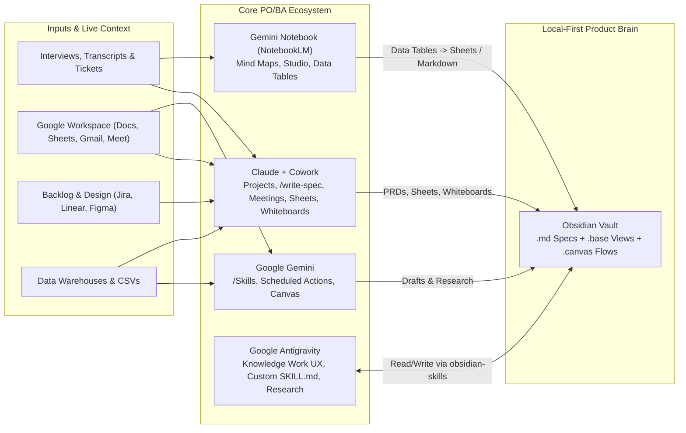

# AI Tools, Skills, Connectors, and Non-Code Workflows for Product Owners & Business Analysts

> [!abstract] Executive Shift: From Ad-Hoc Chat to Reusable Skills & Connected Workspaces
> For Product Owners (POs) and Business Analysts (BAs), the highest-leverage AI shift is no longer one-off prompting in a blank chat box. Across **Claude**, **Google Gemini**, **Gemini Notebook (NotebookLM)**, **Google Antigravity**, and **Obsidian**, work now runs on four composable building blocks:
> 1. **Persistent Context** (Claude Projects, Perplexity Projects, Gemini Workspace grounding, local Obsidian vaults)
> 2. **Portable Skills (`SKILL.md`)** (reusable procedural playbooks and `/` slash-command workflows shared across Claude, Gemini, Antigravity, and Obsidian)
> 3. **Live Connectors** (MCP and native Workspace/BI integrations pulling real tickets, transcripts, emails, and warehouse data)
> 4. **Interactive Artifacts & Local Knowledge Objects** (Claude Sheets/Whiteboards/Data, Gemini Canvas/Sheets Canvas, NotebookLM Studio outputs, Obsidian Bases & JSON Canvas)

---

## Core Ecosystem Architecture (Priority Stack)

Before looking at specialized point tools, POs and BAs get the highest compounding return by anchoring workflows inside five interoperable core platforms:

| Platform | Primary Role for PO / BA | Key Non-Code Capabilities | Primary Sources |
| :--- | :--- | :--- | :--- |
| **Claude** (Anthropic) | Spec drafting, live meeting co-creation, spreadsheet/whiteboard synthesis, connected execution | **Projects**, **Artifacts** & Live Artifacts, **Interactive Connectors** (MCP), **Claude Meetings** (Google Meet beta), **Claude Sheets**, **Claude Whiteboards**, **Claude Data**, **Claude Cowork**, and the open-source **`product-management` plugin** (7 commands, 7 skills) | [Anthropic Projects](https://www.anthropic.com/news/projects), [Agent Skills](https://www.anthropic.com/research/equipping-agents-for-the-real-world-with-agent-skills), [Sheets/Whiteboards/Connectors](https://claude.com/resources/articles/more-ways-to-work-with-claude-sheets-whiteboards-and-interactive-connectors), [Claude Meetings](https://claude.com/resources/articles/claude-meetings), [Claude Cowork](https://support.claude.com/en/articles/13345190-get-started-with-claude-cowork), [PM Plugin](https://claude.com/marketplace/plugins/product-management) |
| **Google Gemini & Workspace** | Cross-app research, recurring briefs, `/` skill stacking, native Docs/Sheets/Meet workflows | **Gemini Skills** (replacing Gems with `/` shortcuts & multi-skill stacking, compatible with `SKILL.md`), **Scheduled Actions** (automated daily/weekly/monthly tasks), **Deep Research** across Drive/Docs/Sheets/Gmail/Chat, **Canvas**, **Sheets Canvas**, **Google Meet** ("Take notes for me") | [Gemini Skills](https://blog.google/products-and-platforms/products/gemini/automate-tasks-with-skills/), [Gems to Skills Guide](https://support.google.com/gemini/answer/18560919?hl=en), [Scheduled Actions](https://blog.google/products-and-platforms/products/gemini/scheduled-actions-gemini-app/), [Gemini Canvas](https://blog.google/products-and-platforms/products/gemini/gemini-collaboration-features/), [Sheets Canvas](https://blog.google/products-and-platforms/products/workspace/sheets-canvas-for-google-sheets-spreadsheets/), [Workspace Deep Research](https://blog.google/products-and-platforms/products/gemini/deep-research-workspace-app-integration/) |
| **Gemini Notebook (NotebookLM)** | Source-grounded discovery synthesis, stakeholder-ready multimedia & tabular exports | **Fast & Deep Research** source gathering, **Studio** outputs: **Mind Maps**, **Audio Overviews** (Deep Dive, Brief, Critique, Debate), **Video Overviews**, **Data Tables** (export to Google Sheets), **Slide Decks**, **Infographics**, and **Reports** | [Studio Upgrades](https://blog.google/innovation-and-ai/models-and-research/google-labs/notebooklm-video-overviews-studio-upgrades/), [Data Tables](https://blog.google/innovation-and-ai/models-and-research/google-labs/notebooklm-data-tables/), [Slide Decks](https://blog.google/innovation-and-ai/models-and-research/google-labs/8-ways-to-make-the-most-of-slide-decks-in-notebooklm/), [Mind Maps Help](https://support.google.com/gemininotebook/answer/16212283?hl=en) |
| **Google Antigravity** | Local-file Knowledge Work orchestrator, custom Skills, multi-agent research & browser-verified UX | **Knowledge Work UX** (hides code diffs/Git/terminal clutter for research, data, and docs), open **`SKILL.md`** architecture with progressive disclosure, subagent workflows, **Scheduled Tasks**, **Design & UX browser verification** | [Antigravity for Knowledge Work](https://antigravity.google/blog/antigravity-for-knowledge-work/), [Antigravity Overview](https://antigravity.google/docs/overview/), [Agent Skills Docs](https://antigravity.google/docs/skills/), [Design & UX Use Case](https://antigravity.google/use-cases/design-ux/) |
| **Obsidian** | Local-first product brain, structured Markdown specs, zero-lock-in databases & spatial boards | Official **`obsidian-skills`** (`obsidian-markdown`, `obsidian-bases`, `json-canvas`, `obsidian-cli`, `defuddle`, `knap`), **Obsidian Bases** (`.base` table/card/list/kanban/map views + formulas), **JSON Canvas** (`.canvas`) | [kepano/obsidian-skills](https://github.com/kepano/obsidian-skills), [Obsidian Bases](https://obsidian.md/help/bases), [Obsidian Canvas](https://obsidian.md/canvas), [JSON Canvas Spec](https://jsoncanvas.org/) |



> [!note] Brief Market Note (Lowest Priority): OpenAI / ChatGPT
> While secondary to the stack above, ChatGPT offers two genuinely distinct features worth noting for completeness: **Deep Research** (multi-step web synthesis paired with read-only workspace integrations) and **Company Knowledge** (workspace-scoped internal search for Business/Enterprise plans alongside **Canvas** side-by-side editing) ([OpenAI Deep Research](https://openai.com/index/introducing-deep-research/), [OpenAI Company Knowledge](https://openai.com/index/introducing-company-knowledge/)).

---

## Lifecycle Stage 1: Discovery & User Research

### Core Ecosystem Workflows

- **Gemini Notebook (NotebookLM)** — *Best for grounded multi-source discovery synthesis*
  - Upload user interview transcripts, competitor PDFs, support exports, and web links—or pull sources directly via **Fast Research** and **Deep Research** from Google Drive and the web.
  - Generate an interactive **Mind Map** from the chat chip into the **Studio** panel to expose hidden thematic relationships across interviews; click any node to ask targeted follow-up questions in chat ([Mind Maps Blog](https://blog.google/innovation-and-ai/models-and-research/google-labs/notebooklm-studying-help/), [Gemini Notebook Help](https://support.google.com/gemininotebook/answer/16212283?hl=en)).
  - Use **Audio Overviews** in **Critique** or **Debate** mode to stress-test discovery hypotheses while commuting, or generate **Video Overviews** and **Reports** to brief teammates without reading 40 pages of transcripts ([Audio Overviews](https://blog.google/innovation-and-ai/products/notebooklm-audio-overviews/), [Studio Upgrades](https://blog.google/innovation-and-ai/models-and-research/google-labs/notebooklm-video-overviews-studio-upgrades/)).
- **Claude (`product-management` Plugin & Projects)** — *Best for structured PM discovery frameworks*
  - Anthropic's official open-source **`product-management`** plugin (for **Claude Cowork** and Claude Code) ships ready-to-use discovery workflows ([PM Plugin Marketplace](https://claude.com/marketplace/plugins/product-management), [GitHub: knowledge-work-plugins](https://github.com/anthropics/knowledge-work-plugins)):
    - `/synthesize-research` (`user-research-synthesis` skill): Digests interview notes, surveys, and Intercom/Fireflies logs into themes, personas, and evidence-backed opportunity areas.
    - `/competitive-brief` (`competitive-analysis` skill): Produces feature matrices, positioning comparisons, and win/loss takeaways.
    - `/brainstorm` (`product-brainstorming` skill): Acts as a sharp sparring partner using **How Might We**, **Jobs-to-be-Done (JTBD)**, **First Principles**, and **Opportunity Solution Trees**, pushing back on premature solutions and proposing cheap assumption tests.
- **Google Gemini** — *Best for internal + market triangulation*
  - **Deep Research** inside Gemini cross-references public market intelligence with private context from **Google Drive (Docs, Sheets, Slides, PDFs), Gmail, and Google Chat** ([Workspace Deep Research](https://blog.google/products-and-platforms/products/gemini/deep-research-workspace-app-integration/)).
  - **Scheduled Actions** automate weekly competitor monitors or industry digests on a recurring cadence without manual prompting ([Scheduled Actions](https://blog.google/products-and-platforms/products/gemini/scheduled-actions-gemini-app/)).
- **Google Antigravity (Knowledge Work UX)** — *Best for local-first, multi-step research synthesis*
  - Using the streamlined **Knowledge Work** profile (which hides code diffs and developer toggles), Antigravity reads local interview repositories, conducts web research, and compiles cited Markdown research briefs directly inside your project folders ([Knowledge Work Blog](https://antigravity.google/blog/antigravity-for-knowledge-work/)).

### High-Impact Specialized Tools

- **Dovetail (Continuous Customer Intelligence)**
  - **Channels**: Ingests continuous high-volume Voice of Customer (VoC) streams—support tickets, NPS verbatims, app reviews, CRM notes, and chat logs—monitoring sentiment shifts and notifying Slack or Teams via AI Agents ([Dovetail Channels](https://dovetail.com/product/ai-channels/)).
  - **Magic Summarize, Search & Clusters**: Automatically summarizes interviews using custom frameworks with source traceability, runs intent-based **Magic Search** across all projects and transcripts, and groups canvas highlights into thematic **Magic Clusters** ([Dovetail Magic Search](https://dovetail.com/changelog/magic-search/), [Dovetail Magic Features](https://dovetail.com/blog/just-like-magic-dovetails-newest-features-are-here/)).
- **Perplexity (Autonomous Market & Internal Discovery)**
  - **Deep Research**: Builds an autonomous research plan and executes parallel retrieval steps across hundreds of sources to produce structured, fully cited market and competitive reports ([Perplexity Deep Research](https://www.perplexity.ai/hub/products/deep-research)).
  - **Projects (formerly Spaces) & Connectors**: Persistent team workspaces combining shared files, custom instructions/skills, and a shared project Brain, paired with **Read and Write Connectors** across Google Drive, Slack, SharePoint, Snowflake, Salesforce, HubSpot, Jira, and Asana ([Perplexity Projects](https://www.perplexity.ai/hub/blog/spaces-are-now-projects), [Perplexity Connectors](https://www.perplexity.ai/hub/academy/how-to-use-connectors)).

---

## Lifecycle Stage 2: Requirements, PRDs & Acceptance Criteria

### Core Ecosystem Workflows

- **Claude (Specs, Live Meetings & Whiteboards)**
  - **`/write-spec` (`feature-spec` skill)**: Converts a rough problem statement or connected Slack/Jira/Figma context into a structured PRD with user stories, requirements prioritization, edge cases, acceptance criteria, and success metrics ([knowledge-work-plugins](https://github.com/anthropics/knowledge-work-plugins)).
  - **Claude Meetings (Google Meet Beta)**: Joins Google Meet calls as a visible participant on Team/Enterprise plans, references connected tools mid-call, and generates live working documents, spreadsheets, or whiteboards *while the workshop is happening*, saving transcripts, summaries, and artifacts to a dedicated meeting page (without storing raw audio) ([Claude Meetings](https://claude.com/resources/articles/claude-meetings), [Use Claude Meetings](https://support.claude.com/en/articles/18325154-use-claude-meetings)).
  - **Claude Whiteboards (Beta)**: Shared visual brainstorming canvas where POs/BAs group requirements by theme, lay out timelines with owners and dates, and ask Claude to convert the board directly into a structured spec document ([Claude Sheets & Whiteboards](https://claude.com/resources/articles/more-ways-to-work-with-claude-sheets-whiteboards-and-interactive-connectors)).
- **Google Gemini & Workspace**
  - **Gemini Skills & Stacking**: Replaces standalone Gems with modular `/` inline skills (supporting markdown `SKILL.md` context files) that can be **stacked** in one prompt—for example, invoking `/prd-standard` + `/edge-case-auditor` inside Gemini or Workspace workflows ([Automate Tasks with Skills](https://blog.google/products-and-platforms/products/gemini/automate-tasks-with-skills/), [Gems to Skills Transition](https://support.google.com/gemini/answer/18560919?hl=en)).
  - **Google Meet ("Take notes for me")**: Automatically captures discussion topics and suggested next steps/action items during Meet calls, delivering a compiled Google Doc to the organizer and attaching it to the Calendar invite ([Google Meet AI Notes](https://knowledge.workspace.google.com/admin/meet/let-google-meet-ai-take-notes-for-my-users)).
  - **Gemini Canvas**: Side-by-side interactive editing surface for iteratively tightening PRDs, functional specs, and executive summaries ([Gemini Collaboration Features](https://blog.google/products-and-platforms/products/gemini/gemini-collaboration-features/)).
- **Google Antigravity**
  - Store team-wide PRD rules and reusable skills in `.agents/skills/` (using `SKILL.md` with `references/` for domain glossaries or compliance templates). Because Antigravity uses **progressive disclosure**, bulky reference specs only load when relevant to the feature being drafted ([Antigravity Skills Docs](https://antigravity.google/docs/skills/)).

### High-Impact Backlog & Roadmapping Tools

- **Productboard Spark (Context-Native Product Agent)**
  - Grounded directly in your Productboard hierarchy, strategy, and 20+ feedback integrations—auto-linking customer insights to feature ideas ([Productboard Spark vs. AI](https://support.productboard.com/hc/en-us/articles/34627987610899-What-s-the-difference-between-Spark-Pulse-and-Productboard-AI)).
  - Supports evidence-backed prioritization (**RICE**, **Value vs. Effort**, customer-segment filtering) and generates delivery-ready PRDs and discovery plans using feedback and strategy context ([Productboard Discovery Frameworks](https://www.productboard.com/blog/ai-product-discovery-frameworks/)).
- **Atlassian Rovo & Jira AI**
  - **Work Breakdown & Drafting**: Breaks epics/large requirements into subtasks using Teamwork Graph context across Jira and Confluence, drafts/refines issue descriptions, suggests Components/Labels/Priority automatically, and translates plain language into JQL or Automation rules ([Jira AI](https://www.atlassian.com/software/jira/ai), [Atlassian Intelligence in Jira](https://support.atlassian.com/organization-administration/docs/atlassian-intelligence-features-in-jira-software/)).
  - **Acceptance Criteria Rigor**: Atlassian Rovo explicitly reads Jira Acceptance Criteria fields (`Acceptance Criteria`, `AC`, `Definition of Done`, `Requirements`) to validate pull requests—rewarding short, single-behavior, unambiguous, measurable AC statements ([Rovo Check Acceptance Criteria](https://support.atlassian.com/rovo/docs/check-acceptance-criteria-in-a-code-review/), [Atlassian Rovo](https://www.atlassian.com/software/rovo)).
- **Linear Triage Intelligence**
  - Analyzes incoming backlog intake against workspace history to recommend **Teams, Projects, Assignees, and Labels** with transparent inline reasoning, flags duplicate or related issues, and supports configurable auto-apply rules under team-specific guidance ([Linear Triage Intelligence](https://linear.app/docs/triage-intelligence)).

---

## Lifecycle Stage 3: Process Modeling & Prototyping

### Core Ecosystem Workflows

- **Claude Artifacts & Whiteboards**
  - Generate clickable interactive UI prototypes, state machines, calculators, and approval workflows inside the side-panel **Artifacts** workspace—or build **Live Artifacts** connected via MCP to external data ([Claude Sheets, Whiteboards & Interactive Connectors](https://claude.com/resources/articles/more-ways-to-work-with-claude-sheets-whiteboards-and-interactive-connectors)).
  - Map user journeys and cross-team timelines on **Claude Whiteboards** before converting them into specs.
- **Google Gemini Canvas & Sheets Canvas**
  - Use **Gemini Canvas** to iterate side-by-side on interactive HTML/React mockups from a PRD, or use **Sheets Canvas** to turn tabular requirements or operational data inside Google Sheets into interactive mini-apps and custom trackers via plain-English prompts ([Gemini Canvas](https://blog.google/products-and-platforms/products/gemini/gemini-collaboration-features/), [Sheets Canvas](https://blog.google/products-and-platforms/products/workspace/sheets-canvas-for-google-sheets-spreadsheets/)).
- **Google Antigravity (Design & UX Verification)**
  - Antigravity's Design & UX workflows combine design-intelligence skills with **browser-in-the-loop verification**, enabling POs and designers to turn qualitative insights into live prototypes and verify rendered states in a real browser ([Antigravity Design & UX](https://antigravity.google/use-cases/design-ux/)).
- **Obsidian JSON Canvas (`.canvas`)**
  - An open, local-first JSON spatial format (`jsoncanvas.org`) for mapping process flows, stakeholder landscapes, and product architecture—linking live Markdown PRDs, PDFs, images, groups, and labeled directional edges ([Obsidian Canvas](https://obsidian.md/canvas), [JSON Canvas](https://jsoncanvas.org/)). Pair with the `json-canvas` skill from `kepano/obsidian-skills` so AI agents generate valid `.canvas` diagrams straight inside your vault.

### High-Impact Diagramming & Rapid Prototyping Tools

| Tool | Best PO / BA Job-to-Be-Done | Key Non-Code Capabilities | Primary Sources |
| :--- | :--- | :--- | :--- |
| **Whimsical AI** | User flows, mind maps, and quick low-fidelity wireframes | Text-to-flowchart & AI mind maps, one-click auto-layout, drag-and-drop wireframe UI library, bidirectional **Mermaid** support, and **Bring Your Own Agent** (connect Claude to generate editable boards) | [Whimsical Diagrams](https://whimsical.com/diagrams), [Whimsical AI Mind Maps](https://whimsical.com/ai/ai-mind-maps) |
| **Eraser (DiagramGPT)** | BPMN, sequence diagrams, ERDs, and system architecture | Generates editable technical diagrams from plain text, PRDs, or schemas using diagram-as-code; ships an **MCP server** so Claude and compatible agents can create, read, and update diagrams | [Eraser DiagramGPT](https://www.eraser.io/diagramgpt) |
| **Lovable** | Full interactive web prototypes for pre-roadmap user testing | Ingests PRDs, Linear/Jira context, and Figma designs to build clickable, data-responsive prototypes in plain English; syncs to GitHub for engineering handoff | [Lovable for PMs](https://lovable.dev/product-managers), [Lovable Prototypes](https://lovable.dev/prototypes) |
| **Vercel v0** | High-fidelity interactive UI prototypes tied to Figma tokens | Turns natural language and pasted **Figma frame URLs** (parsing auto-layout, typography, tokens, and assets) into working interactive React/Tailwind/shadcn prototypes without design drift | [v0 Figma Docs](https://v0.app/docs/figma), [Vercel v0 + Figma Blog](https://vercel.com/blog/working-with-figma-and-custom-design-systems-in-v0) |

---

## Lifecycle Stage 4: BA Data & Metrics Analysis (Without SQL)

### Core Ecosystem Workflows

- **Claude Data & Claude Sheets**
  - **Claude Data (GA)**: Connects directly to enterprise warehouses and CRMs (such as Snowflake and Salesforce) using certified team definitions to generate governed dashboards, analytics, and data stories without writing SQL ([Claude Sheets & Data](https://claude.com/resources/articles/sheets-whiteboards-data), [More Ways to Work with Claude](https://claude.com/resources/articles/more-ways-to-work-with-claude-sheets-whiteboards-and-interactive-connectors)).
  - **Claude Sheets (Beta)**: Generates and co-edits multi-tab workbooks inside Claude with formulas, formatting, drop-down menus, tracked cell edits, and `.xlsx`/CSV export—ideal for financial models, RICE scoring sheets, and cohort tracking.
  - **`/metrics-review` (`metrics-tracking` skill)**: Built into Anthropic's `product-management` plugin (with Amplitude and Pendo MCP support) for KPI hierarchies, OKR alignment, anomaly flagging, and dashboard design ([knowledge-work-plugins](https://github.com/anthropics/knowledge-work-plugins)).
- **Gemini Notebook (NotebookLM) Data Tables + Google Sheets**
  - **NotebookLM Data Tables** extract messy qualitative facts, interview responses, or survey findings across multiple documents into structured comparison tables that export in one click straight into **Google Sheets** ([NotebookLM Data Tables](https://blog.google/innovation-and-ai/models-and-research/google-labs/notebooklm-data-tables/)).
  - Inside **Google Sheets**, Gemini builds custom trackers, writes complex formulas from plain text, categorizes unstructured rows, and powers **Sheets Canvas** interactive analytical views ([Sheets Canvas](https://blog.google/products-and-platforms/products/workspace/sheets-canvas-for-google-sheets-spreadsheets/)).
- **Google Antigravity**
  - In **Knowledge Work UX**, Antigravity runs multi-step analytical workflows across local CSVs and spreadsheet exports, surfacing clean progress tracking and plain-language permission summaries ([Knowledge Work Blog](https://antigravity.google/blog/antigravity-for-knowledge-work/)).

### High-Impact No-SQL BI & Analytics Tools

- **ThoughtSpot Spotter (Agentic Enterprise BI)**
  - Built atop ThoughtSpot's relational search and governed semantic models rather than ungrounded chat; remembers business metric definitions and user corrections across sessions to handle multi-step investigative questions, forecasting, and Liveboard exploration ([ThoughtSpot Spotter Docs](https://docs.thoughtspot.com/cloud/26.10.0.cl/spotter), [ThoughtSpot Agents](https://www.thoughtspot.com/product/agents)).
- **Julius AI (No-Code Spreadsheet & File Analyst)**
  - Upload messy Excel workbooks, Google Sheets, or CSVs and ask analytical questions in plain English; Julius writes, runs, and self-corrects Python/Pandas cleaning, statistical modeling, and visualization code behind the scenes ([Julius AI](https://julius.ai/)).
- **Dot (`getdot.ai`) (Chat-Native Warehouse Analyst)**
  - Lives directly inside **Slack, Microsoft Teams, and email** so BAs and POs can ask ad-hoc data questions without opening a separate BI portal. Dot inspects warehouse schemas, dbt metrics, and LookML documentation to translate plain English into accurate SQL and deliver scheduled analytical findings ([Dot Official](https://www.getdot.ai/)).

---

## Lifecycle Stage 5: Stakeholder Alignment & Knowledge Base (Obsidian + Antigravity)

> [!tip] Why Local-First Obsidian + Antigravity Beats Siloed SaaS Wikis
> Every meeting note, PRD, interview synthesis, and decision record lives as portable plain-text Markdown on your machine. **Obsidian** provides the human graph, database views, and spatial canvas, while **Google Antigravity** and **Claude Cowork** act as agentic operators directly on those same files—eliminating copy-paste synchronization.

### 1. Obsidian as the Local-First Product Operating System

Using the official open-source **[kepano/obsidian-skills](https://github.com/kepano/obsidian-skills)** collection (authored by Obsidian CEO Steph Ango), AI agents natively understand Obsidian's ecosystem:

- **`obsidian-markdown`**: Teaches agents exact Obsidian Flavored Markdown—bidirectional `[[wikilinks]]`, section/block embeds (`![[Note#Heading]]`), callouts (`> [!warning]`), and clean YAML properties.
- **Obsidian Bases (`.base` + `obsidian-bases` skill)**: Turns folders of local Markdown PRDs, research notes, and stakeholder decisions into live **Table, Card, List, Kanban, and Map** views with filters and computed formulas (e.g., automated `RICE = (reach * impact * confidence) / effort` columns), embeddable inside any note via `![[Backlog.base]]` ([Obsidian Bases Help](https://obsidian.md/help/bases)).
- **JSON Canvas (`.canvas` + `json-canvas` skill)**: Creates interactive spatial alignment boards combining live PRD cards, research PDFs, and dependency arrows ([Obsidian Canvas](https://obsidian.md/canvas)).
- **Obsidian CLI (`obsidian-cli`) + `defuddle` & `knap`**: Lets agents interact with a running Obsidian vault via `obsidian` commands (`search`, `property:set`, `daily:append`, `backlinks`) ([Obsidian CLI Help](https://help.obsidian.md/cli)), clip clean web pages into Markdown with `defuddle`, and batch-render structured notes from JSON/CSV templates with `knap`.

### 2. Google Antigravity + Obsidian Daily Workflow

1. **Research & Synthesis into Vault**: Use Antigravity's Knowledge Work UX (or `/research`) to investigate markets, regulations, or competitor features against primary sources and write cited Markdown notes straight into the Obsidian vault.
2. **Skill-Driven Spec Consistency**: Place PO/BA `SKILL.md` files inside your vault's `.agents/skills/` folder so Antigravity automatically formats new PRDs, Architecture Decision Records (ADRs), and glossaries to match your vault's exact frontmatter schema and `[[wikilink]]` structure ([Antigravity Skills](https://antigravity.google/docs/skills/)).
3. **Scheduled Knowledge Hygiene**: Pair Antigravity's Scheduled Tasks (or Gemini Scheduled Actions) to compile weekly stakeholder summaries from daily notes and active project files.

### 3. Executive & Cross-Functional Storytelling

- **Claude Stakeholder Workflows**:
  - **`/stakeholder-update` (`stakeholder-comms` skill)** & **`/roadmap-update` (`roadmap-management` skill)**: Tailors status briefs separately for executives (OKRs, risks, decisions), engineering (dependencies, blockers), and customer-facing teams, and formats roadmaps into Now/Next/Later or quarterly OKR views ([knowledge-work-plugins](https://github.com/anthropics/knowledge-work-plugins)).
- **NotebookLM Presentation Studio**:
  - Turn finalized PRDs, research syntheses, or quarterly roadmaps into custom **Slide Decks** or styled **Infographics** (*Bento Grid, Sketch Note, Editorial, Professional*) straight from the Studio panel ([NotebookLM Slide Decks](https://blog.google/innovation-and-ai/models-and-research/google-labs/8-ways-to-make-the-most-of-slide-decks-in-notebooklm/), [NotebookLM Studio Upgrades](https://blog.google/innovation-and-ai/models-and-research/google-labs/notebooklm-video-overviews-studio-upgrades/)).

---

## Ready-to-Use PO/BA Skills & Copy-Paste Prompts

### Part A: Copy-Paste RCTF Prompts (Role, Context, Task, Format)

#### 1. Discovery Synthesis & Opportunity Sizing *(NotebookLM / Claude / Gemini)*
```text
Role: Act as a Principal Product Researcher and Business Analyst.
Context: Below are raw transcripts/notes from [N] user interviews and support tickets regarding [feature/problem area]. Our target persona is [persona], and our strategic objective this quarter is [OKR/metric].
Task:
1. Extract recurring pain points, workarounds, and unmet Jobs-to-be-Done.
2. Separate stated feature requests from underlying root problems.
3. Flag contradictions across user segments and identify gaps requiring follow-up validation.
Format: Output a Markdown table with columns [Theme | Frequency (X/N sources) | Direct Verbatim Evidence | Severity (1-5) | Root Problem Statement | Recommended Low-Cost Experiment]. Follow with Top 3 Risks/Unknowns.
```

#### 2. PRD & Testable Acceptance Criteria Authoring *(Claude `/write-spec` / Gemini Canvas / Jira)*
```text
Role: Act as a Senior Technical Product Owner and Business Analyst.
Context: We are building [feature name] for [user role]. Problem evidence: [paste summary]. Technical/business constraints: [auth, permissions, compliance, latency, legacy system rules].
Task:
1. Draft a concise, unambiguous PRD covering Problem Statement, Out-of-Scope boundaries, and Success Metrics (leading + lagging).
2. Decompose the scope into INVEST-compliant User Stories.
3. For every story, write positive and negative Acceptance Criteria using Given/When/Then, explicitly covering empty states, permission failures, validation boundaries, and audit/telemetry events.
Format: Structured Markdown using H2/H3 sections, a Scope vs. Non-Goals table, and numbered Given/When/Then blocks ready to paste into Jira Acceptance Criteria fields.
```

#### 3. Process Edge-Case & State Flow Modeling *(Whimsical / Eraser DiagramGPT / Claude Artifacts)*
```text
Role: Act as a Lead Systems Business Analyst specializing in workflow reliability.
Context: Here is our proposed user/system workflow for [process name]: [paste steps or rough notes]. Involved actors: [Actor A, Actor B, System/API].
Task:
1. Audit the flow for missing decision branches, race conditions, timeout/retry paths, role-handoff bottlenecks, and rollback states.
2. Produce a clean happy-path and exception-path process flow.
Format:
1. A valid Mermaid `flowchart TD` diagram showing actors, decision diamonds, and error/fallback paths.
2. A bulleted Exception Matrix table: [Step | Failure Mode | User-Facing Behavior | Recovery Owner].
```

#### 4. No-SQL Metric & Funnel Investigation *(Claude Data / Julius AI / ThoughtSpot Spotter / Dot)*
```text
Role: Act as a Product Analytics Business Analyst.
Context: Dataset/table attached covers [product area] over [date range]. Key funnel events or columns: [list key fields]. Business question: [e.g., Why did Week-2 activation drop for School Admin users?].
Task:
1. Check data hygiene first (null rates, duplicate IDs, timezone/date cutoffs, denominator consistency).
2. Segment conversion/retention across [cohort, plan tier, onboarding path, device].
3. Distinguish statistically meaningful shifts from low-sample noise and list possible confounding factors.
Format: Executive Summary (3 bullets max) -> Data Quality Caveats -> Segmented Comparison Table -> Top 3 Actionable Hypotheses to test next.
```

#### 5. Audience-Adapted Stakeholder Alignment Brief *(Claude `/stakeholder-update` / Gemini / Antigravity)*
```text
Role: Act as a Staff Product Manager communicating across leadership and delivery teams.
Context: Here are our raw sprint notes, completed research, and current blockers: [paste daily notes / Jira summary / meeting transcript].
Task: Distill this raw material into two distinct stakeholder views without inventing unverified metrics:
- Executive View: Outcome progress against goals, key decisions made (with rationale), active risks + mitigation owners, and decisions needed this week.
- Delivery/Ops View: Scope changes, cross-team dependencies, unresolved AC questions, and next-milestone readiness.
Format: Two clearly labeled Markdown sections (max 250 words each), bulleted with bold action owners and explicit "Decisions Needed From You" at the top.
```

---

### Part B: Portable Non-Code `SKILL.md` Blueprints

Because **Claude Skills**, **Google Gemini Skills**, and **Google Antigravity** all support the open **`SKILL.md`** pattern (YAML `name` + `description` + concise step-by-step instructions), you can author a single skill folder and reuse it across tools.

#### Skill 1: `prd-and-ac-architect`
```markdown
---
name: prd-and-ac-architect
description: >-
  Drafts and audits Product Requirements Documents (PRDs) and testable Acceptance Criteria
  for non-technical POs and BAs. Use whenever creating a feature spec, refining backlog
  stories, or reviewing requirements for ambiguity and missing edge cases.
---

# PRD & Acceptance Criteria Architect

## Workflow
1. **Challenge Scope First**: Before drafting, verify the problem statement, target persona, and explicit Non-Goals. Ask up to 3 clarifying questions if permissions, data ownership, or success metrics are undefined.
2. **Structure the PRD**:
   - Context & Evidence (link source research/tickets)
   - Target Personas & Permissions Matrix
   - Functional Requirements (grouped by Must / Should / Could)
   - Explicit Non-Goals (Out of Scope)
   - Leading & Lagging Success Metrics
3. **Write Testable Acceptance Criteria**:
   - Keep each criterion atomic (one behavior per statement), positive, and measurable so downstream reviewers or AI agents (e.g., Rovo) can verify it unambiguously.
   - Use `Given / When / Then` and always include at least: happy path, validation error, unauthorized role, and empty/loading state.
4. **Edge-Case Self-Check**: Append an "Open Questions & Assumptions" table listing owner and target resolution date.
```

#### Skill 2: `discovery-to-obsidian-synthesis`
```markdown
---
name: discovery-to-obsidian-synthesis
description: >-
  Transforms raw interview transcripts, meeting recaps, or support feedback into structured,
  linked Obsidian Markdown notes with YAML frontmatter and evidence tables. Use after any
  user interview, stakeholder call, or discovery dump.
---

# Discovery-to-Obsidian Synthesis

## Workflow
1. **Emit Valid Obsidian Frontmatter**: Include `title`, `date` (YYYY-MM-DD), `type: discovery-insight`, `persona`, `source`, `confidence` (`high | medium | low`), and `tags`.
2. **Ground Every Claim**: Pair each synthesized theme with at least one verbatim quote and source citation—never extrapolate unstated frequencies.
3. **Link to Vault Knowledge**: Connect themes to existing vault notes using `[[wikilinks]]` (e.g., `[[Master-Persona]]`, `[[Backlog-Epic]]`).
4. **Actionable Framing**: Close with a `> [!question] Hypotheses to Validate` callout listing the riskiest assumption and the fastest non-code experiment (prototype, survey, or concierge test) to test it.
```

#### Skill 3: `stakeholder-exec-translator`
```markdown
---
name: stakeholder-exec-translator
description: >-
  Converts messy sprint notes, Jira updates, or technical discussions into concise,
  decision-oriented stakeholder updates tailored to Executives, Engineering, or Support/Ops.
  Use when preparing weekly updates, steering committee readouts, or launch comms.
---

# Stakeholder Executive Translator

## Workflow
1. **Identify Audience & Goal**: Confirm whether the output targets Executives (ROI, OKRs, risks, decisions), Engineering/QA (dependencies, scope trade-offs, AC blockers), or Customer Success/Support (user-facing changes, workarounds, launch timing).
2. **Lead with Decisions & Status**: Put RAG status (`Green | Amber | Red`) and explicit "Decisions Needed" in the first 5 lines.
3. **Strip Jargon & Noise**: Replace implementation mechanics with user/business impact for non-engineering audiences.
4. **Verify Completeness**: Ensure every risk has a named owner and mitigation step, and clearly separate confirmed facts from estimates.
```

#### Skill 4: `no-sql-kpi-hygiene-audit`
```markdown
---
name: no-sql-kpi-hygiene-audit
description: >-
  Guides Business Analysts and Product Owners through rigorous metric reviews and data
  sanity checks without writing SQL. Use before presenting dashboard screenshots, CSV
  analyses, or experiment results to stakeholders.
---

# No-SQL KPI Hygiene Audit

## Workflow
1. **Definition Alignment**: State the exact numerator, denominator, inclusion/exclusion filters, and time window for every KPI cited.
2. **Sanity Check Inputs**: Verify sample size ($n$), missing/null rows, bot/internal-test account filtering, and timezone consistency before interpreting trends.
3. **Check Confounders**: Test whether apparent changes are driven by seasonality, pricing/tier mix shifts, or tracking instrumentation changes.
4. **Decision Framing**: End every metric summary with: (a) What changed, (b) Why we believe it changed (evidence vs. hypothesis), and (c) What product decision changes as a result.
```

---

## Verified Primary Sources Index

- **Claude & Anthropic**:
  - [Introducing Projects](https://www.anthropic.com/news/projects)
  - [Equipping Agents for the Real World with Agent Skills](https://www.anthropic.com/research/equipping-agents-for-the-real-world-with-agent-skills)
  - [The Complete Guide to Building Skills for Claude (PDF)](https://resources.anthropic.com/hubfs/The-Complete-Guide-to-Building-Skill-for-Claude.pdf)
  - [More Ways to Work with Claude: Sheets, Whiteboards, and Interactive Connectors](https://claude.com/resources/articles/more-ways-to-work-with-claude-sheets-whiteboards-and-interactive-connectors)
  - [Claude Whiteboards, Claude Sheets, and Claude Data](https://claude.com/resources/articles/sheets-whiteboards-data)
  - [Claude Meetings](https://claude.com/resources/articles/claude-meetings) | [Use Claude Meetings (Support)](https://support.claude.com/en/articles/18325154-use-claude-meetings)
  - [Get Started with Claude Cowork](https://support.claude.com/en/articles/13345190-get-started-with-claude-cowork)
  - [Claude Product Management Plugin](https://claude.com/marketplace/plugins/product-management) | [anthropics/knowledge-work-plugins](https://github.com/anthropics/knowledge-work-plugins)
- **Google Gemini & Workspace**:
  - [Automate Tasks with Skills in Gemini](https://blog.google/products-and-platforms/products/gemini/automate-tasks-with-skills/) | [Transition from Gems to Skills (Help)](https://support.google.com/gemini/answer/18560919?hl=en)
  - [Scheduled Actions in the Gemini App](https://blog.google/products-and-platforms/products/gemini/scheduled-actions-gemini-app/)
  - [Gemini Collaboration Features (Canvas)](https://blog.google/products-and-platforms/products/gemini/gemini-collaboration-features/)
  - [Bring Your Spreadsheet Data to Life with Sheets Canvas](https://blog.google/products-and-platforms/products/workspace/sheets-canvas-for-google-sheets-spreadsheets/)
  - [Deep Research with Google Workspace Integration](https://blog.google/products-and-platforms/products/gemini/deep-research-workspace-app-integration/)
  - [Google Meet: Let AI Take Notes for My Users](https://knowledge.workspace.google.com/admin/meet/let-google-meet-ai-take-notes-for-my-users)
- **Gemini Notebook (NotebookLM)**:
  - [NotebookLM Studio Upgrades & Video Overviews](https://blog.google/innovation-and-ai/models-and-research/google-labs/notebooklm-video-overviews-studio-upgrades/)
  - [NotebookLM Data Tables](https://blog.google/innovation-and-ai/models-and-research/google-labs/notebooklm-data-tables/)
  - [8 Ways to Make the Most of Slide Decks in NotebookLM](https://blog.google/innovation-and-ai/models-and-research/google-labs/8-ways-to-make-the-most-of-slide-decks-in-notebooklm/)
  - [NotebookLM Mind Maps](https://blog.google/innovation-and-ai/models-and-research/google-labs/notebooklm-studying-help/) | [Gemini Notebook Mind Maps Help](https://support.google.com/gemininotebook/answer/16212283?hl=en)
  - [NotebookLM Audio Overviews](https://blog.google/innovation-and-ai/products/notebooklm-audio-overviews/)
- **Google Antigravity**:
  - [Antigravity for Knowledge Work](https://antigravity.google/blog/antigravity-for-knowledge-work/)
  - [Antigravity Documentation Overview](https://antigravity.google/docs/overview/)
  - [Antigravity Agent Skills Docs](https://antigravity.google/docs/skills/)
  - [Antigravity Design & UX Use Case](https://antigravity.google/use-cases/design-ux/)
- **Obsidian**:
  - [kepano/obsidian-skills](https://github.com/kepano/obsidian-skills)
  - [Obsidian Bases Help](https://obsidian.md/help/bases)
  - [Obsidian Canvas](https://obsidian.md/canvas) | [JSON Canvas Specification](https://jsoncanvas.org/)
  - [Obsidian CLI Help](https://help.obsidian.md/cli)
- **Discovery, Diagramming, Prototyping, Analytics & Backlog Tools**:
  - [Dovetail AI Channels](https://dovetail.com/product/ai-channels/) | [Magic Search](https://dovetail.com/changelog/magic-search/) | [Magic Features](https://dovetail.com/blog/just-like-magic-dovetails-newest-features-are-here/)
  - [Perplexity Deep Research](https://www.perplexity.ai/hub/products/deep-research) | [Projects (formerly Spaces)](https://www.perplexity.ai/hub/blog/spaces-are-now-projects) | [Connectors](https://www.perplexity.ai/hub/academy/how-to-use-connectors)
  - [Whimsical Diagrams](https://whimsical.com/diagrams) | [Whimsical AI Mind Maps](https://whimsical.com/ai/ai-mind-maps)
  - [Eraser DiagramGPT](https://www.eraser.io/diagramgpt)
  - [ThoughtSpot Spotter Docs](https://docs.thoughtspot.com/cloud/26.10.0.cl/spotter) | [ThoughtSpot Agents](https://www.thoughtspot.com/product/agents)
  - [Julius AI](https://julius.ai/)
  - [Dot (getdot.ai)](https://www.getdot.ai/)
  - [Lovable for Product Managers](https://lovable.dev/product-managers) | [Lovable Prototypes](https://lovable.dev/prototypes)
  - [Vercel v0 Figma Integration](https://v0.app/docs/figma) | [v0 + Design Systems Blog](https://vercel.com/blog/working-with-figma-and-custom-design-systems-in-v0)
  - [Atlassian Jira AI](https://www.atlassian.com/software/jira/ai) | [Atlassian Rovo](https://www.atlassian.com/software/rovo) | [Atlassian Intelligence in Jira](https://support.atlassian.com/organization-administration/docs/atlassian-intelligence-features-in-jira-software/) | [Rovo Acceptance Criteria Check](https://support.atlassian.com/rovo/docs/check-acceptance-criteria-in-a-code-review/)
  - [Linear Triage Intelligence](https://linear.app/docs/triage-intelligence)
  - [Productboard Spark vs. Productboard AI](https://support.productboard.com/hc/en-us/articles/34627987610899-What-s-the-difference-between-Spark-Pulse-and-Productboard-AI) | [AI Product Discovery Frameworks](https://www.productboard.com/blog/ai-product-discovery-frameworks/)
- **OpenAI (Brief Comparative Reference)**:
  - [Introducing Deep Research](https://openai.com/index/introducing-deep-research/) | [Introducing Company Knowledge](https://openai.com/index/introducing-company-knowledge/)
