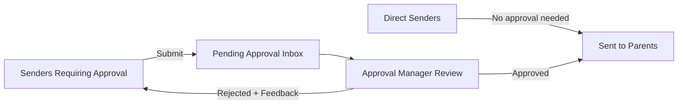

# 02 — Actionable Messages

> [!abstract] Navigation
> **Hub**: [[_Master Document Hub]] | **Mental Model**: [[00 - How Schoolvoice Works (Product Mental Model)]] | **Prev**: [[01 - Overview & Value Proposition]] | **Next**: [[03 - Chat & Voice Calls]]

> [!tip] Product Lens — Why Actionable Messages Exist
> Passive texts get read and forgotten. Turning school notices into **structured 1-tap CTA cards**—backed by pre-send Approval Workflows, `Message Merge`, `10-minute Fallback SMS`, and non-responder-only `Smart Reminders`—drives near-100% guardian completion without spamming parents who already acted.

**Actionable Messages** is Schoolvoice's flagship feed-style communication module. Instead of passive text blasts, every message arrives as a structured card with **preset one-tap CTA buttons** that prompt immediate parent action.

---

## Message Card Anatomy (7 Components)

```
┌─────────────────────────────────────────────────────┐
│ [Avatar / School Logo]  Sender Name   [Date] [Urgent]│
│ ─────────────────────────────────────────────────── │
│ Message Summary (brief preview of content)          │
│                                                     │
│ [Child's Photo]  <-- Clarifies which child          │
│ [Attachments: PDF / Image / Video / URL]            │
│                                                     │
│ [Reminder Indicator]                                │
│ [  Primary Action Button(s): Approve / Pay / ...  ] │
└─────────────────────────────────────────────────────┘
```

1. **Sender Identity**: Sender's name + personal photo or school logo/name.
2. **Date & Urgency Indicator**: Timestamp and urgency flag (if marked urgent).
3. **Message Summary**: Brief preview of the message body in the main news feed.
4. **Child's Image**: Visual photo identifying exactly which child the message concerns.
5. **Action Buttons**: Prominent bottom CTAs (`Read`, `Approve`/`Reject`, `Acknowledge`, `Reply`, `Pay`, `Submit Reason`, `View Moment`, `Call`).
6. **Urgency & Reminder Indicators**: Visual tags highlighting overdue or high-priority requests.
7. **Attachments**: Supporting multimedia or documents.

---

## The 8 Actionable Message Types

| # | Message Type | Action Button(s) | Special Rules / Security / Formats | Typical Use Cases |
| :---: | --- | --- | --- | --- |
| 1 | **Announcement** | `Read` | General informational broadcast | Upcoming events, evening notices, Eid/New Year greetings, school milestones |
| 2 | **Approval Request** | `Approve`, `Reject` | ==Requires parent **PIN code** authentication== on tap | Field trip consent, special events, project participation |
| 3 | **Acknowledge Request** | `Acknowledge` | Confirms receipt & understanding | Schedule updates, school policy changes, critical notices |
| 4 | **Reply Request** | `Reply` | Supports **`1-to-many`** (private individual replies) or **`many-to-many`** (open group discussion) | Collecting updated birth certificates, passport copies, phone/address updates, feedback |
| 5 | **Payment Request** | `Pay [amount]` | Integrated quick & secure in-app fee payment | Field trip fees, school expenses, activity payments |
| 6 | **Absence & Tardiness Note** | `Submit Absence Reason` / `Submit Tardiness Reason` | Customizable templates & predefined reasons; supports **Doctor's Note / Official Excuse upload** | Daily absence tracking (`Sick`, `Family Emergency`, `Doctor's Appointment`, `Other`) & late arrivals (`Traffic`, `Medical`, `Other`) |
| 7 | **Moment Message** | `View Moment` | Shares memorable photos & videos | Event highlights, extracurricular activities, student achievements |
| 8 | **Emergency Alerts** | `Call` | ==Full-screen takeover + distinct sound bypassing silent mode==; simultaneous reach to all guardians; initiates call to predefined emergency contact | On-campus medical accidents, urgent allergy checks, critical safety alerts |

> [!example]- Absence & Tardiness Customization Details
> - **Predefined Absence Reasons**: `Sick`, `Family Emergency`, `Doctor's Appointment`, `Other` (open text) + upload Doctor's Note / Official Absence Excuse.
> - **Predefined Tardiness Reasons**: `Traffic`, `Medical appointments`, `Other` (open text) + upload Doctor's Note / Official Late Excuse.
> - Schools can fully edit message templates and add/modify predefined reasons to match local attendance policies.

---

## Cross-Actionable Message Features (18 Capabilities)

### 1. Targeting & Recipient Selection
| Feature | How It Works |
| --- | --- |
| **Advanced Message Targeting** | Target by Grade, Section, Group, or combined multi-criteria filters (e.g., specific section in Grade 5). |
| **Easy Recipient Selection** | 4 methods: **(1)** Student name autocomplete, **(2)** Multi-level dropdown (`Grade → Section → Student`), **(3)** Comma-separated student school IDs, **(4)** Bulk CSV upload of student IDs/names. |
| **Staff CC** | Add staff members as CC recipients for informational visibility; ==CC copies omit action buttons==. |

### 2. Composition, Rich Media & Personalization
| Feature | How It Works |
| --- | --- |
| **Multimedia Content Support** | Supports text, rich font formatting (styles, sizes, emphasis, bullets), photos, videos, documents (`PDF`, `Word`, `Excel`), and hyperlinks/URLs. |
| **Personalization Variables** | Dynamically injects per-recipient values: `#parent_name`, `#student_name`, `#student_grade`, `#student_section`, `#student_grade_section`, `#sending date`. |
| **Message Merge** | Connects personalization to external storage (e.g., Google Drive folders tagged by student ID) to ==auto-match and attach individualized files== (grade cards, progress reports, certificates, custom invites). |
| **Sender Name Selection** | Toggle between School Name (official branding) and Individual Sender Name (personal touch); restricted by user role/permissions. |
| **Draft Saving** | Save incomplete messages securely in-account for collaboration, review, and later sending. |

### 3. Timing, Urgency & Delivery Reliability
| Feature | How It Works |
| --- | --- |
| **Urgent Marking** | Checkbox adds a visual urgent indicator directly on the parent's message card. |
| **Scheduling** | Queue messages for automatic delivery at a future date and time. |
| **Action Deadline** | Set a cutoff date/time; once expired, ==action buttons auto-disable== to stop late responses. |
| **Smart Reminder** | Sends push notifications **only** to parents who have not acted yet, ==bumps the card to the top of the feed==, and displays a reminder badge—eliminating spam for parents who already responded. |
| **Fallback SMS** | If enabled, checks app delivery after a predefined interval (e.g., `10 minutes`) and ==auto-sends an SMS only to parents who haven't received the in-app message== (no app or offline). |

### 4. Governance & Post-Send Control
| Feature | How It Works |
| --- | --- |
| **Approval Workflow** | Enforces quality control before sending (see workflow diagram below). |
| **View Other Sent Messages** | Permission allowing principals/managers to audit sent messages by selected staff for tone and policy compliance. |
| **Action Button Manual Control** | Toggle action buttons on/off at any time from Message Details—==even after the message is sent==. |
| **Message Recall** | Disables mistaken/erroneous messages on parent devices, labels the card `"Recalled Message"`, and retains it as an audit record rather than erasing history. |
| **Message Delete** | *(Heading #16 in source doc — ==no specification written yet==)* |



---

## Reporting & Push Notifications

### Real-Time Message Reports (Per Message)
All actionable message reports contain three core sections and export to **PDF** or **CSV**:

1. **Action Status Chart**: % of parents who acted, did not act, or are pending response.
2. **Read & Delivery Status Chart**: % of parents who received, did not receive, and read the message.
3. **Detailed Per-Student Breakdown**:
   - **Student Name** & **Delivery Status**
   - **Action Taken** (e.g., Approved, Rejected, Acknowledged) & **Timestamp**
   - **Action History**: Full audit log if a parent changes their mind/action later
   - **Parent feedback attachment**: *(Listed in source doc without description)*

### Push Notification Triggers
- **New message**
- **Reminders** (Smart Reminders)
- **Other parent action** across `Approval`, `Acknowledgment`, `Payment`, and `Attendance` (e.g., when one guardian acts, notifying the other)
