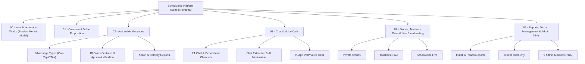

# Master Document — Persona: School

> [!abstract] Executive Summary
> **Schoolvoice** is an all-in-one, privacy-first school–parent communication and engagement platform designed around ==zero-friction parent UX== (regardless of age or technical background) and ==full administrative governance== for schools and ministries.
> - **Start Here (Mental Model & Flows)**: [[00 - How Schoolvoice Works (Product Mental Model)]]
> - **Domain Glossary & Discovery**: [[CONTEXT|Domain Glossary]] · [[discovery-notes|Product Discovery & UI Notes]]
> - **Visual Ecosystem Map**: [[Schoolvoice Context Map.canvas]]
> - **Interactive Database**: [[Schoolvoice Modules.base]]
> - **PO Workspace Links**: [[Most-important|Stakeholder Priorities]] · [[1-TO-DO|Onboarding Checklist]] · [[After On-Boarding To-Do|Delete Messages Story Task]]

> [!tip] Recommended 15-Minute Understanding Path
> 1. Open [[Schoolvoice Context Map.canvas]] for the 1-screen **ecosystem flow** (Personas -> 3 Loops -> Governance -> Gaps).
> 2. Read [[00 - How Schoolvoice Works (Product Mental Model)]] to understand **how the modules reinforce each other** and avoid common term mix-ups.
> 3. Skim [[01 - Overview & Value Proposition]] for positioning, then dive deep into [[02 - Actionable Messages]] (flagship) -> [[03 - Chat & Voice Calls]] -> [[04 - Stories, Teachers Drive & Live Broadcasting]] -> [[05 - Reports, District Management & Admin TBAs]].

> [!info]- External Source Links
> - [Master Document — Persona: School (Google Doc)](https://docs.google.com/document/d/1Pc3ZklC-CE0nURaoT34AqI0Wh_rmZxAv7rhPXetab7o/edit?tab=t.0#heading=h.8jlh6gupbvr7) *(Owner: `ali.binyahia@schoolvoice.com` · Last modified: `2026-09-12`)*
> - [Master Document Index](https://docs.google.com/document/u/0/d/1boYrzUG4ewozJA5X48lFTy28VUaGoZiTzxVVrZvwi9o/edit)
> - [Master Document Mind Map (XMind)](https://xmind.ai/MdJa1HAY?xid=5sBt8BfT)

---

## Platform Architecture

---

## Structured Notes Index

| Order | Note | Product Layer | Key Highlights | Spec Gaps |
| :---: | --- | --- | --- | :---: |
| 00 | [[00 - How Schoolvoice Works (Product Mental Model)]] | **Start Here / Flows** | 3-loop ecosystem, 5-persona matrix, request sequence, concept contrast | — |
| 01 | [[01 - Overview & Value Proposition]] | **Foundation** | UX mission, 10 value pillars, top-list vs. body coverage audit | 2 discrepancies |
| 02 | [[02 - Actionable Messages]] | **Structured Action Loop** | 7-part card, 8 message types, 18 cross-features, live reports | 2 partial/empty |
| 03 | [[03 - Chat & Voice Calls]] | **Two-Way Interaction Loop** | Chat channels, authorized extraction, recorded VoIP with hours/quotas | — |
| 04 | [[04 - Stories, Teachers Drive & Live Broadcasting]] | **Daily Habit & Resources** | Private stories, cloud folders, live video Q&A | 1 empty metric |
| 05 | [[05 - Reports, District Management & Admin TBAs]] | **Governance & Backlog** | Install/Reach reports, multi-school districts, 9 Admin TBAs | 9 full TBAs |

---

## Module & Gap Explorer

![[Schoolvoice Modules.base#Study Deck (Cards)]]

---

## PO Audit: Discrepancies & Missing Specs

> [!warning] Source Document Gaps to Clarify with Stakeholders
> 1. **Overview vs. Body Mismatch — Rewards & Challenges**: Listed as Module #4 in the overview (`Schoolvoice Modules`), has ==no dedicated section== in the document, and only reappears as `Challenges management: TBA` under Admin Modules.
> 2. **Overview vs. Body Mismatch — Voice Calls**: Has a comprehensive dedicated section (`Voice Calls`), yet is missing from the top 6-module list.
> 3. **9 Admin Modules Marked `TBA`**: Contact, Permission, Challenges, Absence, School Structure, School Profile, Modules Management, SMS Settings, and Admin Logs are all stubs (`TBA`).
> 4. **Empty Placeholders in Body**:
>    - `Message delete` (heading #16 under Cross Actionable Features has no text — compare with your active onboarding task in [[After On-Boarding To-Do]]!).
>    - `Parent feedback attachment:` (bullet under Actionable Messages Reports has no description).
>    - `Views:` (bullet under Stories interactive features has no description).
>
> See [[05 - Reports, District Management & Admin TBAs#PO Gap & TBA Tracker]] for the actionable checklist.
